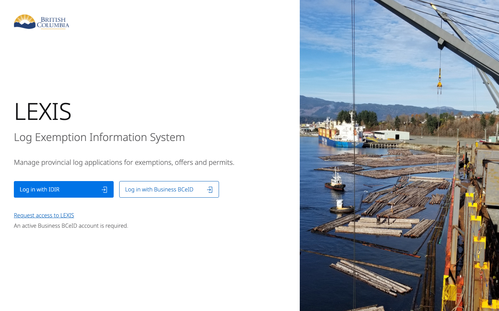
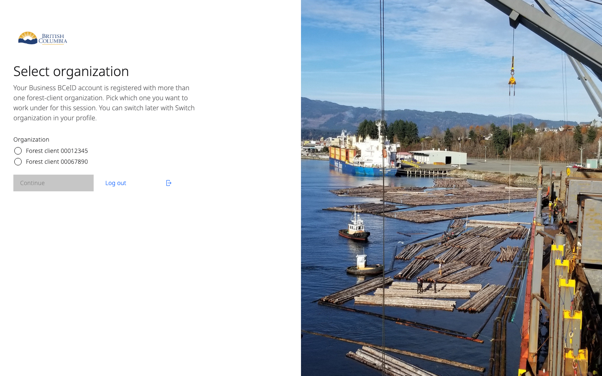
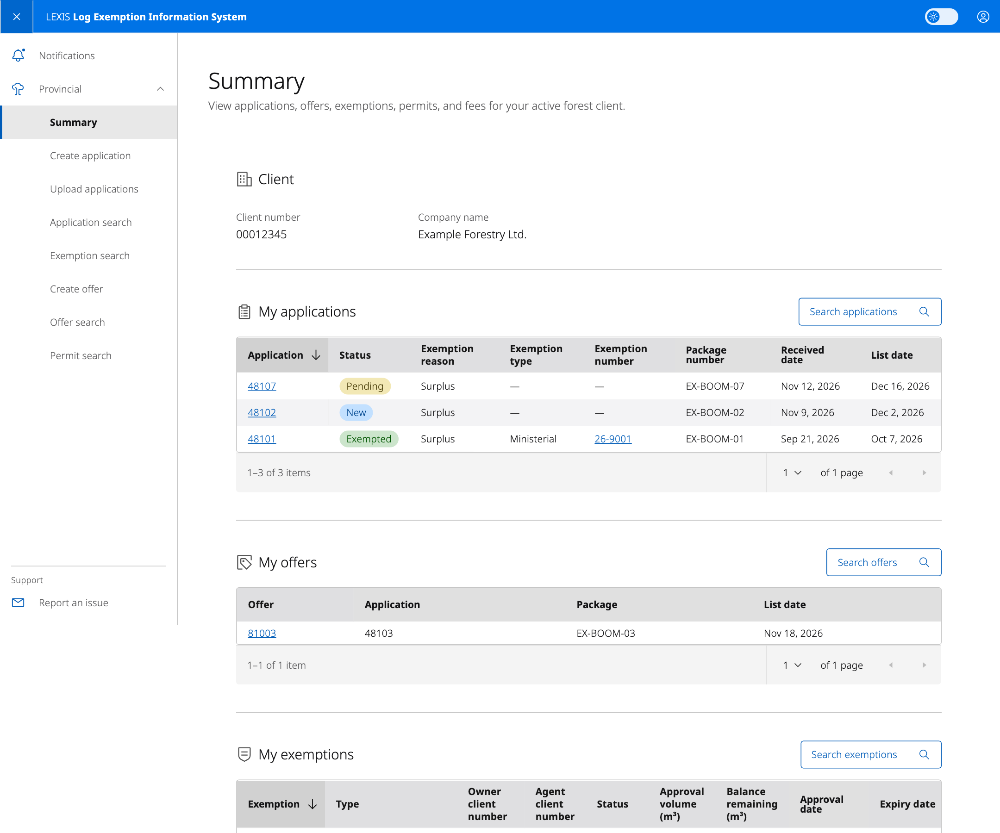
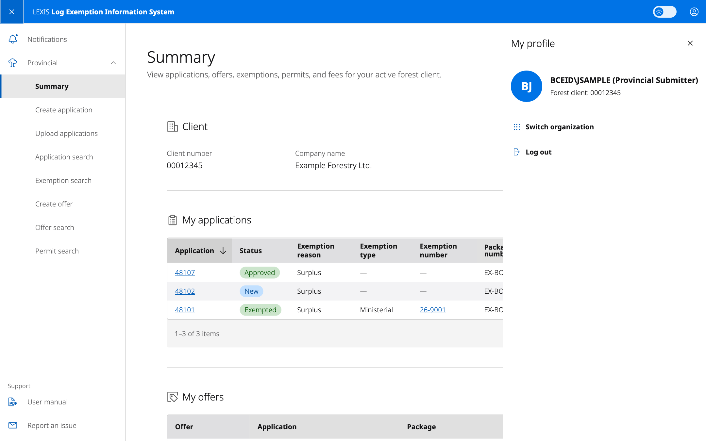
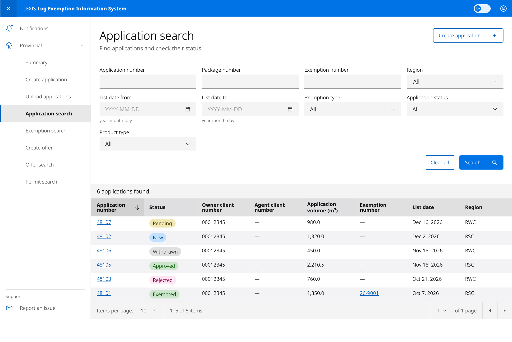

# 1. Getting started

## Getting access

To use LEXIS you need:

- a **Business BCeID** account for your company, with a user ID for each
  person who will use LEXIS;
- a **Ministry of Forests client number** for the company. If your company
  doesn't have one, ask the export office when you request access.

To request access, open LEXIS and select **Request access to LEXIS** on the
login page. It tells you where to send your request and what to include.

Email the export office for the region where the logs are harvested:

| Region | Email |
|---|---|
| Coast and MFPR | Provincial.Log.Export.Analyst@gov.bc.ca |
| North | NorthAreaExportScaling@gov.bc.ca |
| South | Export.Applications@gov.bc.ca |

Include your name, email address, phone number, Business BCeID username, the
company you represent as an employee or agent (with its authorization) and
its Ministry of Forests client number.

An agent can apply on behalf of a company. The company must authorize it,
and the agent's access is granted for that company's client number.

## Logging in

1. Open LEXIS and select **Log in with Business BCeID**.
2. Sign in on the BC Government page with your BCeID user ID and password.
   If you have forgotten them, use the BCeID help on that page.

If LEXIS says **Access not granted** after you sign in, your account has no
LEXIS role yet. Contact the export office.

## Choosing an organization

If your Business BCeID is registered with more than one forest client, LEXIS
asks you to **Select organization** after you log in. Choose the forest
client you want to work under and select **Continue**.

Everything you see and do applies to that one organization. To change it,
open your profile and select **Switch organization**. You don't need to log
out.

## The Summary page

After you log in, LEXIS opens **Provincial › Summary**. It is your home
page: one table for each kind of record your organization has.

| Table | Shows |
|---|---|
| **My applications** | Your applications for exemption, with status, exemption number, package numbers, received date and list date. |
| **My offers** | Offers other companies have placed on your applications. |
| **My exemptions** | Your exemptions, and the Blanket Order in Council exemptions open to every applicant, with approved volume and balance remaining. |
| **My permits** | Your permits and permit requests. A request that isn't issued yet shows **(Pending)** beside its number. |
| **My fees** | Total fees for each permit. Select **Display fees** to calculate them. |
| **Offers placed** | Offers your organization has placed on other companies' applications. |

Select a number to open that record. Select a column heading to sort, where
the heading allows it. Each table shows 10 rows at a time. The button beside
a table's title, for example **Search applications**, opens the full search
for that kind of record.

## Finding your way around

The left-hand menu holds **Notifications** and the **Provincial** group:

| Menu item | Opens |
|---|---|
| **Notifications** | Notices from LEXIS administrators, such as a planned outage. A dot on the bell means there is an active notice. Each notice disappears after its end date. |
| **Summary** | Your home page. |
| **Create application** | A new application for exemption. See [Applications](02-applications.md). |
| **Upload applications** | Applications sent as files. |
| **Application search** | Your applications. |
| **Exemption search** | Your exemptions. See [Exemptions](04-exemptions.md). |
| **Create offer** | A new offer on an advertised application. See [Offers](03-offers.md). |
| **Offer search** | Offers you placed and offers on your applications. |
| **Permit search** | Your permits. See [Permits](05-permits.md). |

Select the menu button at the top left to collapse the menu to icons or open
it again. **LEXIS** in the header takes you back to your home page. The
switch beside your profile turns the dark theme on and off.

Permits have no "create" menu item: you request a permit from the exemption
it is issued against.

Under **Support**, at the bottom of the menu, **User manual** downloads this
manual and **Report an issue** starts an email to the LEXIS support team.

## Your profile

Select the person icon in the header to open **My profile**. It shows your
user ID, your role and the forest client you are working under. From there
you can **Switch organization** (if you have more than one) and **Log out**.

## Searching

The four search screens work the same way.

1. Fill in the filters you need. They are all optional.
2. Select **Search**, or press Enter. Nothing is searched until you do.
3. The number of records found shows above the results. Select a column
   heading to sort, where the heading allows it. Use the pager under the
   table to change page or show 10, 25, 50, 100 or 200 rows.
4. Select the record number to open it. Ctrl-click (Command-click on a
   Mac) opens it in a new tab using your active Business BCeID sign-in.
   If prompted, choose the organization for this record and select **Continue**.

**Clear all** empties the filters and the results.

Type dates as year-month-day, for example `2026-09-28`. Press Tab to move
to the next field, Down Arrow to enter the calendar, or Escape to close it.
Both ends of a date range share one calendar.

When you open a record from a search, the **Back to** link above its title
returns you to the same results. Your search is also kept if you reload the
page or use the browser's Back button. It is not kept after you log out.

## Working with records

An application, offer, exemption or permit opens as a record with sections
or tabs.

- A record opens for reading. Select the edit button on a card, for
  example **Edit application details** or **Edit offer**, to change it,
  then **Save changes** or **Cancel**. On applications, exemptions and
  permits, a tab shows its save confirmation above the card you edited.
- An edit button appears only when you are allowed to change that card
  and the record's status still permits it.
- Fields marked with a red asterisk (`*`) are required.
- A message under a field tells you what to correct. Nothing is saved until
  every message is cleared.
- Empty values show as a dash.

If you move to another page with unsaved changes, LEXIS asks **Discard
changes?** Select **Keep editing** to stay.

> **If someone else changed the record first**, LEXIS tells you the record
> was updated and your changes were not saved. Select **Refresh** to load the
> latest version, then make your change again.

## Adding documents to a record

Applications, exemptions and permits each have a **Documents** tab. A
document stays with the record as it moves from application to exemption to
permit, so the permit's **Documents** tab also lists the documents added to
its application.

1. Open the **Documents** tab and select **Add documents**.
2. Drag files onto the panel, or select it to choose them. You can add
   several at once.
3. LEXIS checks each file, including a virus scan. A file that fails shows
   the reason: remove it and try another copy.
4. Add a **Description** for each file if its name doesn't make clear what
   it is (up to 250 characters).
5. Select **Save documents**.

Accepted file types are BMP, CSV, DOC, DOCX, JPG, PDF, PNG, RTF, TXT, XLS,
XLSX, XML and ZIP, up to 20 MB each.

In the list, **Open** shows a PDF, image or text file in a new tab,
**Download** saves a copy, and **Delete** removes the document where you are
allowed to. Check with your regional export office which documents it needs.

## Session time-out and logging out

LEXIS logs you out after **25 minutes** of inactivity across all LEXIS
tabs in the same browser. At the **5-minute** warning, select **Stay logged in**.

Save your changes before stepping away or logging out. To log out, open
your profile and select **Log out**. This closes the session immediately.
