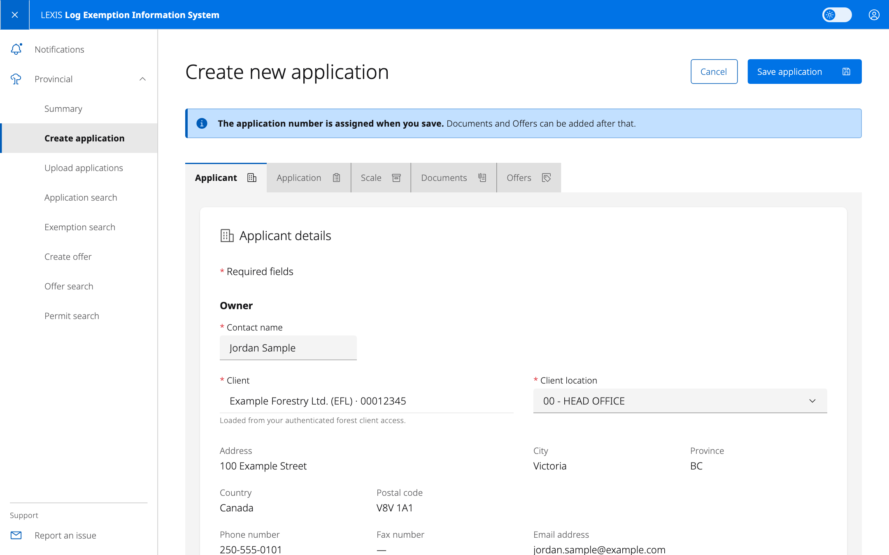
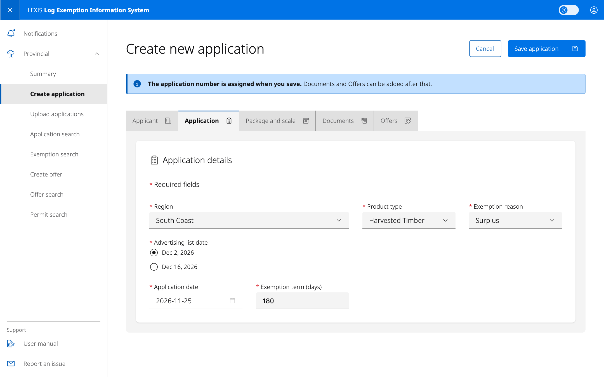
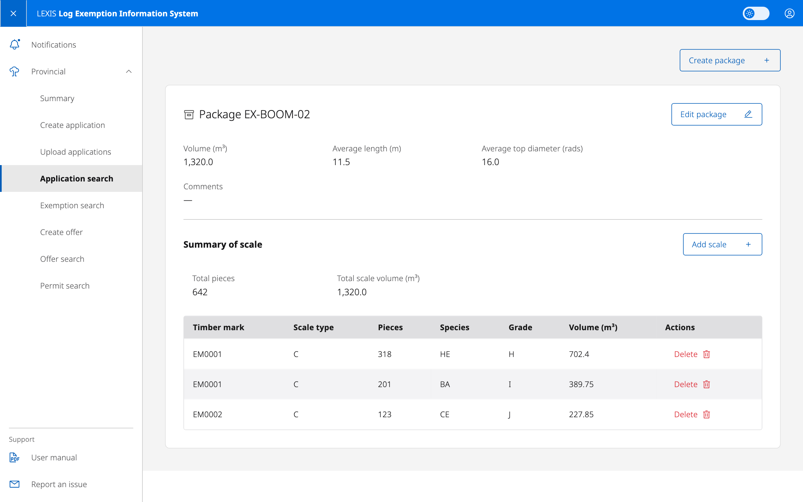
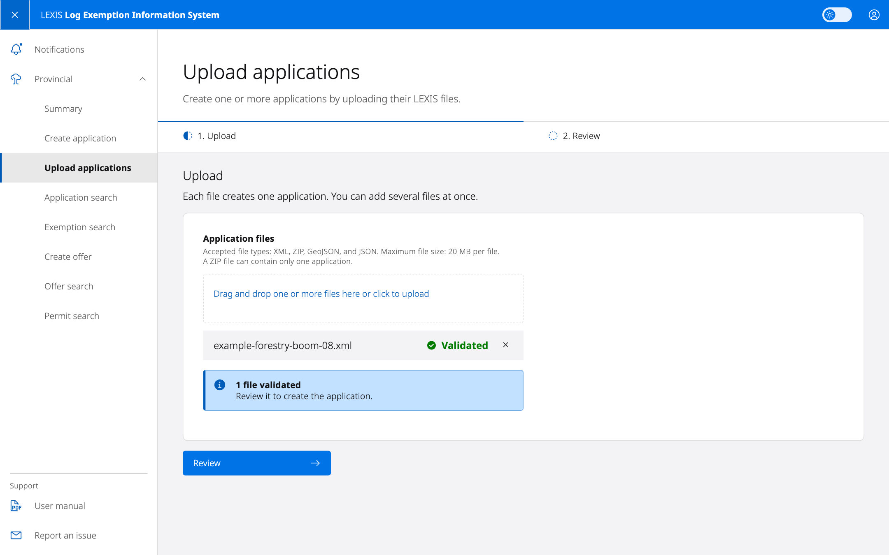

# 2. Applications

An application for exemption asks to export unmanufactured timber from
British Columbia. You can enter an application on screen or upload it as a
file. Export office staff review it on its list date. An approved
application is advertised on the Advertising List, where other companies can
make offers on it.

> **Advertising Lists:** each Advertising List is active for two weeks. All
> Advertising Lists and the Export Schedule can be found at
> [Weekly Advertising Lists](https://www2.gov.bc.ca/gov/content?id=EEC95AA8942A4E3BA7A71C707E6F2BF5).

## Screens

| Menu item | Use it to |
|---|---|
| **Provincial › Create application** | Enter a new application on screen. |
| **Provincial › Upload applications** | Create one or more applications from files. |
| **Provincial › Application search** | Find your organization's applications and check their status. |
| **Provincial › Summary** | See your latest applications under **My applications**. |

## Application statuses

| Status | What it means |
|---|---|
| **New** | Saved and waiting for review by the export office. |
| **Approved** | Approved for advertising on its list date. |
| **Rejected**, **Withdrawn** | Not advertised. The export office gives the reason. |
| **Exempted** | Included in an exemption. Search results show **Exempted - New** until the exemption is approved. |
| **Permitted** | Included on a permit. |
| **Expired** | Its exemption has expired. |

## Common tasks

### Enter an application

1. **Provincial › Create application**. Fill in the **Applicant**,
   **Application** and **Package and scale** tabs. The other tabs open once the
   application is saved.
2. On the **Applicant** tab, **Client** is your organization. Choose the
   **Client location**. **Contact name** fills in with the location's contact
   on file; change it if needed. The location's address, phone and email
   show underneath.
3. On the **Application** tab, enter:
   - **Region**: the region where the logs were harvested;
   - **Product type**, which starts on harvested timber;
   - **Exemption reason**, which starts on surplus;
   - **Advertising list date**: one of the next two list dates;
   - **Exemption term (days)**, which starts at 180.

   **Application date** is today's date and can't be changed.
4. On the **Package and scale** tab, under **Advertising details**, enter:
   - **Location of logs** (up to 250 characters);
   - **Age class**;
   - **Average log volume (m³)**, to one decimal place (for example, `1.2`);
   - **Application volume (m³)**;
   - **Species list**: choose every species that applies. The list depends
     on the region and product type;
   - **End use**, which depends on the region and species.
5. Select **Save application**.
6. In **Confirm application details**, tick **I confirm the application
   details are accurate** and select **Save application** again.

LEXIS assigns the application number and opens the new application. If a
tab still has something to correct, a red count shows on it and the message
is under the field.

An application for a given list date must be saved by the final date for
receipt of applications in the published
[Export Schedule](https://www2.gov.bc.ca/gov/content?id=EEC95AA8942A4E3BA7A71C707E6F2BF5).

### Apply as an agent

If you are an agent acting for the owner of the timber, tick **I'm an
agent** on the **Applicant** tab.

- Your organization moves to **Agent information** as the **Agent client**.
  Choose the **Agent location**. The agent's **Contact name** fills in from
  it and can be changed.
- **Client** becomes a search. Type at least three characters of the
  owner's name, acronym or client number and choose the owner, then its
  **Client location**. The owner's **Contact name** fills in the same way.

The owner and the agent must be different clients.

### Add packages and the summary of scale

Packages (booms) and their summary of scale are added on the saved
application's **Package and scale** tab.

1. Select **Create package**.
2. Enter the **Package number** (unique, up to 20 characters), **Volume
   (m³)**, **Average length (m)** and **Average top diameter (rads)**, and
   any **Comments**.
3. Select **Save package**.
4. Under **Summary of scale**, select **Add scale** for each line: **Timber
   mark**, **Pieces**, **Species**, **Grade** and **Volume (m³)**. Select
   **Save scale**.

LEXIS capitalizes the **Timber mark** as you type. Select the **Grade** by
its code. **Total pieces** and **Total scale volume (m³)** add up as you go.

| Rule | Detail |
|---|---|
| Package volume | The packages together can't be more than the application volume. |
| Scale volume | The scale lines together can't be more than their package's volume. |
| Timber mark | Must be valid for the application's region. |
| Scale lines | A package can hold one line for each combination of timber mark, species and grade. |

To correct a scale line, select **Delete** on the line and add it again.
**Edit package** changes a package. **Delete package** is offered only for a
package with no scale lines. When an application has more than one package,
choose the one to work on in **Selected package**.

> **When scale is needed:** timber harvested on the coast must be scaled
> before it is advertised. For interior applications, package and scale
> details are needed before you request a permit. Check with your regional
> export office.

### Upload applications as files

1. **Provincial › Upload applications**.
2. Drop your files on **Application files**, or select it to choose them.
   Each file creates one application. Files can be XML, ZIP, GeoJSON or JSON,
   up to 20 MB each. A ZIP file can hold only one application.
3. LEXIS checks each file as it is added, including a virus scan, and marks
   it **Validated** or **Failed**. The reasons for a failure are listed
   under **Validation issues**, and **Download issues (.csv)** saves them.
   Correct the file and add it again.
4. Select **Review** and check **Applications to create**. Expand a row to
   see its details.
5. Select **Create … application(s)**.

The result page lists the applications created, with their numbers, and any
file that was not created with the reason.

- The file must name your organization as the owner or the agent.
- Each application is created as **New** on the next open list date, with a
  180-day term, its package and its summary of scale.
- No email is sent. The results are on screen only.

For the file format, ask your regional export office.

### Change an application

Open the application and select the edit button on the card you want to
change: **Edit applicant details**, **Edit application details** or **Edit
advertising details**. Each save asks you to tick **I confirm the application
details are accurate**.

- You can change a **New** application up to and including its list date.
- You can change an **Approved** application only before its list date, and
  not the list date itself.
- If a change to the **Species list** rules out the **End use**, **End use** is
  cleared and you choose another.
- The owner can add or remove an agent only before the list date. If your
  organization is the agent, you can't remove the agent.
- After that, the edit buttons are no longer shown. Ask your regional
  export office if something must change.
- You can add and delete documents on the **Documents** tab until the
  application is on a **Complete** permit. Documents listed from a permit
  can't be deleted here.

Packages and scale lines follow their own rules:

- After approval you can still add a package if the application had none
  when it was approved, and add scale lines if it had none.
- While the application is on a Ministerial exemption that still has balance
  remaining, you can always add and change packages and scale lines.
- Otherwise, once the application is on a **Complete** permit, nothing more
  can be added or deleted.
- A scale line on a completed permit can't be deleted.

If the application volume is larger than the package volumes together, the
confirmation also shows a warning: "The sum of the package volume is less
than the total application volume." You can still save.

### Check whether an application is approved

The status shows beside the application number on the record, in **My
applications** on the Summary page, and in **Application search**, where you
can filter by **Application status**.

No email is sent when an application is approved. When one is rejected or
withdrawn, the export office normally emails the owner, and the agent if
there is one, with the reason.

> **Tip:** if a package needs to be re-sorted or is sold domestically while
> it is advertised, ask your regional export office to withdraw the
> application.

### Find an application

In **Provincial › Application search** you can filter by **Application
number**, **Package number**, **Exemption number**, **Region**, the list
date range, **Exemption type**, **Application status** and **Product type**. The
results show each application's status, owner and agent client numbers,
volume, exemption number, list date and region. Select the application
number to open it, or the exemption number to open its exemption.

### See the offers on an application

The **Offers** tab on an application lists the company name and the date and
time received for each offer placed on it. See [Offers](03-offers.md).
