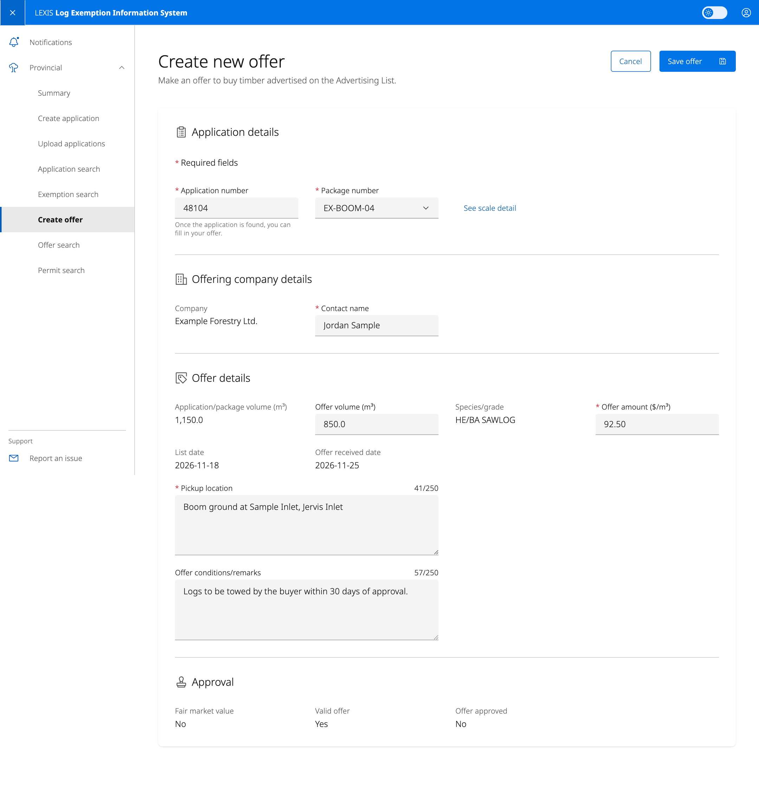
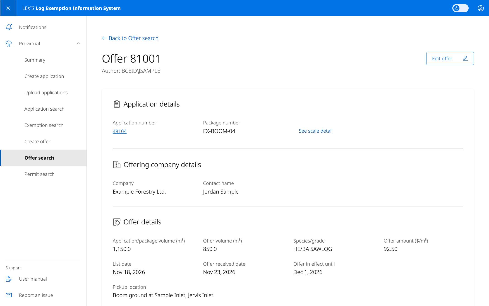

# 3. Offers

Applications approved for advertising appear on the Advertising List. Any
company with LEXIS access can offer to buy that timber. This chapter covers
placing an offer, following the offers on your own applications, and
changing or withdrawing an offer you placed.

Offers are accepted from the application's list date until the final date
for receipt of offers in the published Schedule for the Advertising List.

## Screens

| Menu item | Use it to |
|---|---|
| **Provincial › Create offer** | Place an offer on an advertised application. |
| **Provincial › Offer search** | Find offers your organization placed, and offers placed on applications where your organization is the owner or the agent. |
| **Provincial › Summary** | See **My offers** (offers on your applications) and **Offers placed** (offers your organization made). Withdrawn offers are not listed. |

## Common tasks

### Place an offer

1. **Provincial › Create offer**.
2. Enter the **Application number** from the Advertising List. LEXIS checks
   the number as soon as you enter it. The rest of the form appears once the
   application is found.
3. If the application has packages, choose the **Package number**. Select
   **See scale detail** to view the package's summary of scale: timber mark,
   pieces, species, grade and volume. An application with no packages shows
   **No packages**, and your offer is for all or part of the application
   volume.
4. Under **Offering company details**, **Company** is your organization and
   can't be changed. Enter the **Contact name**.
5. Under **Offer details**, check that **Application/package volume (m³)**,
   **Species/grade** and **List date** match the advertised information.
   Then enter:
   - **Offer volume (m³)**, which can't be more than the application or
     package volume;
   - **Offer amount ($/m³)**;
   - **Pickup location** (up to 250 characters);
   - **Offer conditions/remarks**, if you have any (up to 250 characters).
6. Select **Save offer**.

LEXIS assigns the offer number and opens the offer record. The number is in
the page title, for example **Offer 81001**. Keep it for your records: you
can't search by offer number.

If the application can't take your offer, the reason shows under
**Application number**:

| Message | What it means |
|---|---|
| Application … does not exist | Check the number against the Advertising List. |
| … does not have a valid jurisdiction to accept offers | It is not a provincial application. |
| … does not have a valid status to accept offers | The application is no longer open, for example it was rejected or withdrawn. |
| … can not accept offers until *date* | Its list date hasn't arrived yet. |
| … is no longer accepting offers | The final date for receipt of offers has passed. |
| … does not have a valid listing date | Contact the regional export office. |

Your company can have one offer on each package, or one offer on an
application with no packages. A withdrawn offer still counts. If you already
have one, LEXIS doesn't save the new offer and shows **This company already
has an offer on this package** (or **on this application with no package**).
Open your existing offer to change it.

### Who is told about your offer

When you save, LEXIS emails the applicant and copies the regional export
office. You can't edit or skip this email. The notice at the top of the
offer record tells you what was sent.

> **If the notice says no email was sent**, the applicant has no email
> address on file. Your offer is saved, but you must let the applicant and
> the regional export office know about it another way.

### Follow an offer

Open the offer from **Provincial › Summary** or **Provincial › Offer
search**. The **Approval** section shows the decision recorded by ministry
staff: **Fair market value**, **Valid offer** and **Offer approved**. You
can't change these.

In **Offer search** you can filter by **Application number**, **Package
number**, **Region**, and the list date and withdrawn date ranges. Select the
number in the **Offer** column to open the record.

On one of your own applications, the **Offers** tab lists the company name
and the date and time received for each offer on it.

### Change an offer

1. Open the offer and select **Edit offer**.
2. Change **Offer volume (m³)**, **Offer amount ($/m³)**, **Pickup
   location** or **Offer conditions/remarks**.
3. Select **Save changes**.

LEXIS emails the applicant and the regional export office about the update.
Only the organization that placed the offer can change it.

### Withdraw an offer

You can withdraw an offer you placed up to the day before the "offers must
be withdrawn by" date in the published schedule.

1. Open the offer and select **Edit offer**.
2. Under **Offer withdrawals**, set **Offer withdrawal date** to today's
   date and enter an **Offer withdrawal reason** (up to 250 characters).
3. Select **Save changes**.

LEXIS emails the applicant and copies the regional export office. As with a
new offer, if the notice says no email was sent, tell them yourself.

Once the deadline has passed, the **Offer withdrawals** section says so and
the fields are locked. Ask your regional export office to withdraw the offer
for you.
