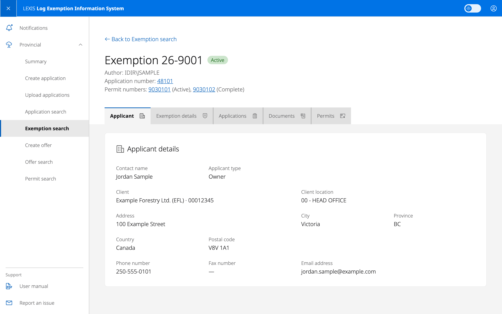

# 4. Exemptions

An exemption authorizes the export of a volume of timber until its expiry
date. You don't create exemptions. Ministry staff create them, and once an
exemption is **Active** you request permits against it.

## Exemption types

| Type | What it is | Which ones you see |
|---|---|---|
| **Ministerial** | A Ministerial Order for timber that passed the surplus test. Staff create it from your approved applications, and it is approved on behalf of the Minister. | Those with an application where your organization is the owner or the agent. |
| **Order in Council** | An exemption issued for a specific applicant. | Those with an application where your organization is the owner or the agent. |
| **Blanket Order in Council** (Blanket OIC) | An exemption for a region or circumstance, not for one applicant. | All of them. Any applicant who meets its conditions can request a permit against it. |

## Exemption statuses

| Status | What it means |
|---|---|
| **New** | Created but not yet approved. Permits can't be requested. |
| **Active** | Approved. Permits can be requested until the expiry date. |
| **Cancelled** | Cancelled by ministry staff. |
| **Expired** | Past its expiry date. Its applications and permits expire with it. |

## Screens

| Menu item | Use it to |
|---|---|
| **Provincial › Exemption search** | Find your exemptions and the Blanket OIC exemptions. |
| **Provincial › Summary** | See **My exemptions**, with the approved volume and balance remaining. |

## Common tasks

### Find an exemption

1. **Provincial › Exemption search**.
2. Filter by **Exemption number**, **Application number**, **Package
   number**, **Region**, the list date range, **Exemption type** or
   **Exemption status**, and select **Search**.
3. Select the number in the **Exemption** column.

A list date range finds an exemption when one of your applications on it is
listed in that range. Blanket OIC and OIC exemptions have no list date, so a
list date search leaves them out.

The results show each exemption's type, status, owner and agent client
numbers, **Approval volume (m³)**, **Balance remaining (m³)**, list date,
expiry date and region.

### Read an exemption

| Tab | Shows |
|---|---|
| **Applicant** | The owner's contact, client, location and address, and the agent's when there is one. Ministerial exemptions only. |
| **Exemption details** | **Status**, **Exemption type**, **Exemption holder**, **Approval date**, **Expiry date**, **Approval volume (m³)**, and any **Conditions**. A Blanket OIC also shows its **Region**. |
| **Applications** | The applications on the exemption and their total requested volume. Not shown for a Blanket OIC. |
| **Documents** | Documents added to the exemption and to its applications. |
| **Permits** | The permits requested against the exemption. This is where you apply for a new one. |
| **Fees** | **Override fee rate?** and the **Fee rate ($/m³)** when the exemption sets a fixed rate. Shown for Order in Council and Blanket OIC exemptions, and for some Ministerial ones. |

On the **Permits** tab of a Ministerial or Order in Council exemption, the
totals show how much of the exemption is used:

- **Requested volume (m³)**: the volume of its applications;
- **Approval volume (m³)**: the volume approved;
- **Sum of application scales (m³)**: the scale already on permits;
- **Balance remaining (m³)**: what can still go on a permit.

### When your exemption is approved

When a Ministerial exemption is approved, the regional export office
normally emails the owner, and the agent if there is one. The email gives
the exemption number and lists its application numbers. The exemption's
status changes from **New** to **Active**.

### Add documents to an exemption

Use **Add documents** on the **Documents** tab of a Ministerial or Order in
Council exemption. See [Getting
started](01-getting-started.md#adding-documents-to-a-record). You can't add
documents to a **New** exemption or to a Blanket OIC exemption. Add them to
your permit instead.

### Request a permit

Open the **Permits** tab of an **Active** exemption and select **Apply for
new permit**. See [Permits](05-permits.md).
