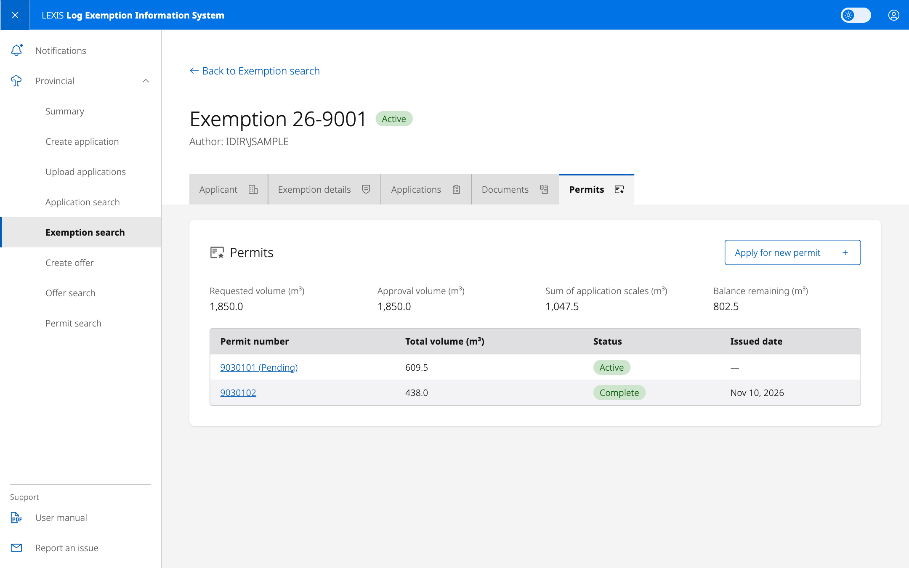
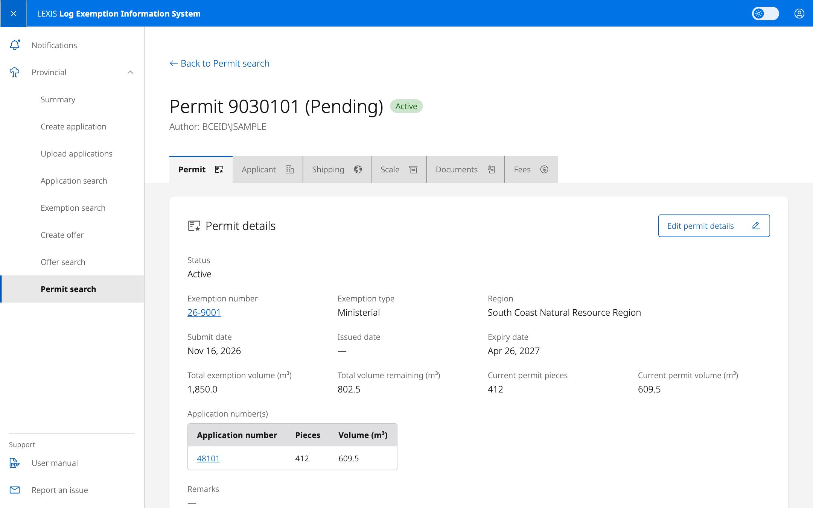
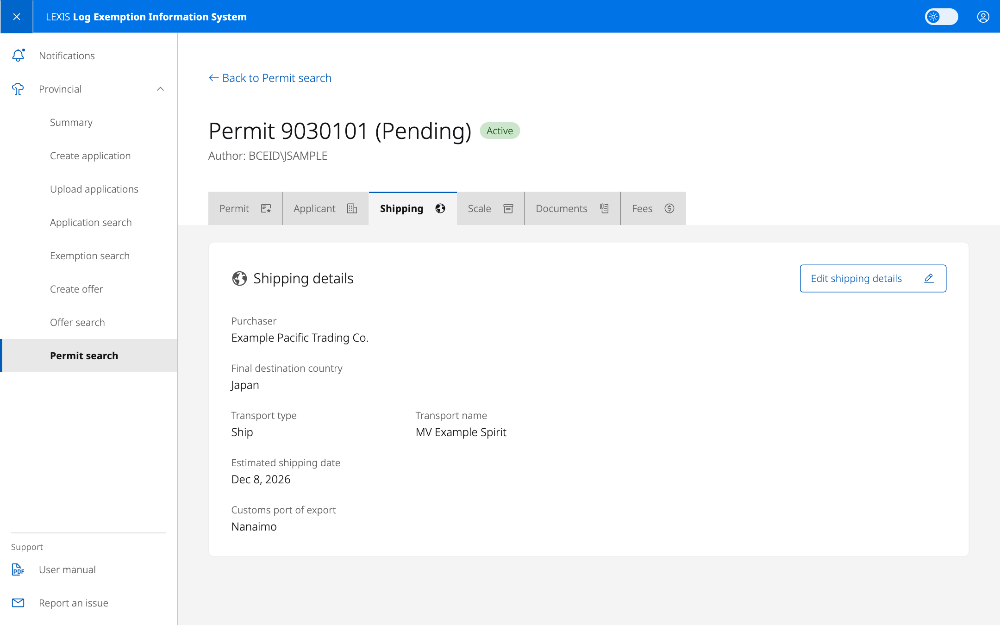
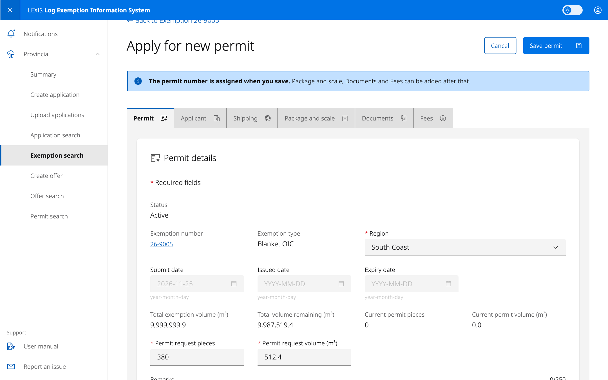
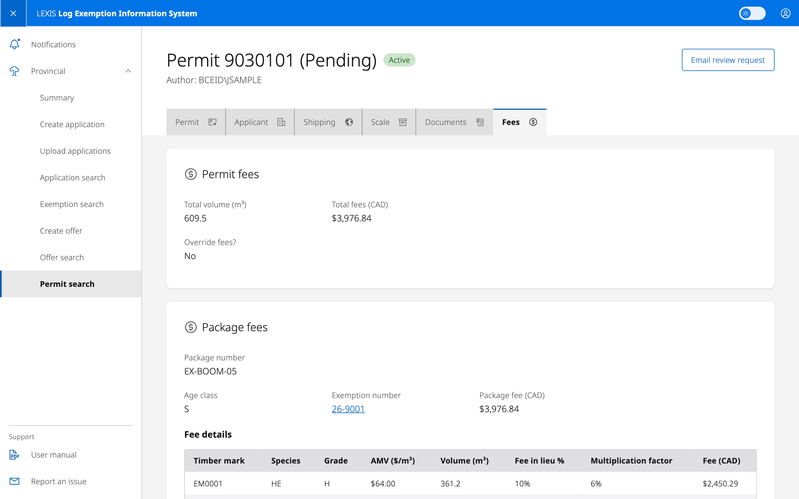

# 5. Permits

Once an exemption is **Active**, you apply for a provincial permit to export
the timber, and pay the fee in lieu of manufacture. You request the permit
in LEXIS, the regional export office reviews and issues it, and you print
the issued permit.

## How a permit request moves

1. Open the **Active** exemption and select **Apply for new permit** on its
   **Permits** tab.
2. Complete the permit: what is being shipped, the applicant, the shipping
   details and any documents.
3. Select **Email review request** to tell the regional export office the
   request is ready.
4. Export office staff review the request, confirm the fee in lieu and
   record the payment or invoice.
5. Staff set the permit to **Complete** and normally email the owner that
   it is approved.
6. Select **Print permit** to get the permit as a PDF, ready for your
   federal export permit application.

## Permit statuses

| Status | What it means |
|---|---|
| **Active** | A request that is not issued yet. The number shows **(Pending)** beside it. |
| **Payment pending** | An interior permit that staff have completed without a receipt number. It becomes **Complete** when payment is recorded. |
| **Complete** | Issued. You can print it. |
| **Cancelled** | Cancelled by ministry staff. |
| **Expired** | Its exemption has expired. |

## Screens

| Menu item | Use it to |
|---|---|
| **Provincial › Permit search** | Find your permits by permit number, application number, package number, region, issued date or status. |
| **Provincial › Summary** | See **My permits** and, with **Display fees**, **My fees**. |
| **Provincial › Exemption search** | Open the exemption to start a new permit. |

**Permit search** lists a permit only once it has scale. To find a permit
you have just started, use **My permits** on the Summary page or the
exemption's **Permits** tab.

A permit record has these tabs: **Permit**, **Applicant**, **Shipping**,
**Scale**, **Documents**, **Fees** and, once the permit has been invoiced,
**GBMS**.

## Common tasks

### Request a permit against a Ministerial exemption

1. Open the exemption from **Provincial › Exemption search** and select its
   **Permits** tab.
2. Select **Apply for new permit**, then **Create permit**. A permit can't
   be deleted once it is created.

3. The new permit opens as **Permit … (Pending)** with its details ready to
   fill in. Under **Application number(s)**, tick **Include in permit** for
   each application to ship on this permit. **Current permit pieces** and
   **Current permit volume (m³)** follow your choice.
4. On the **Applicant** tab, the owner and agent come from the application.
   You can change the **Client location**, for example to have the invoice
   sent to another of the company's addresses. The client itself can't be
   changed.
5. On the **Shipping** tab, enter:
   - **Purchaser**: the company name;
   - **Final destination country**: the most common countries are listed
     first, and you can type to search;
   - **Transport type** and **Transport name**;
   - **Estimated shipping date**;
   - **Customs port of export**. If the port isn't listed, choose **Other**
     and enter the **Other port of export name**.
6. Select **Save changes**.
7. On the **Scale** tab, check each package's **Summary of scale**. To leave
   a scale line off this permit, select **Edit scale selection**, clear its
   **Include in permit** tick and save.
8. Add any documents the export office needs on the **Documents** tab.
9. Select **Email review request**.

An application can go on a permit only if it has a package with a summary
of scale that isn't already on another permit. If it has none, open the
application, add the package and scale on its **Scale** tab (see
[Applications](02-applications.md#add-packages-and-the-summary-of-scale)),
then come back to the permit. The **Exemption number** on the **Permit** tab
links back to the exemption, and each application number links to its
application.

A permit against an **Order in Council** exemption is started the same way.
LEXIS adds every eligible scale line from the exemption's applications to it
automatically.

### Request a permit against a Blanket OIC exemption

1. Open the **Active** Blanket OIC exemption from **Provincial › Exemption
   search** and select its **Permits** tab.
2. Select **Apply for new permit**, then **Continue**. The **Apply for new
   permit** form opens. Nothing is created until you save it.
3. On the **Permit** tab, choose the **Region** and enter the **Permit
   request pieces** and **Permit request volume (m³)**. Add **Remarks** if
   you need to. **Submit date** is today's date.
4. On the **Applicant** tab, **Client** is your organization. Choose the
   **Client location**. If you are an agent, tick **I'm an agent**: your
   organization becomes the **Agent client** and you search for the owner.
5. Fill in the **Shipping** tab as for a Ministerial permit.
6. Select **Save permit**. LEXIS assigns the permit number and opens the
   permit.

Then add what is being shipped, on the saved permit's **Scale** tab:

1. Select **Create package** and enter the **Package number** (unique, up
   to 20 characters), **Species list**, **End use**, **Age class**, **Volume
   (m³)**, **Average length (m)** and **Average top diameter (rads)**.
   Select **Save package**.
2. Under **Summary of scale**, select **Add scale** for each line: **Timber
   mark**, **Pieces**, **Species**, **Grade** and **Volume (m³)**. Select
   **Save scale**. You can type the timber mark in lowercase and select
   the grade by its code.
3. Add documents on the **Documents** tab, then select **Email review
   request**.

| Rule | Detail |
|---|---|
| Region | Can't be changed after the first package is created. |
| Package volume | The packages together can't be more than the permit request volume. |
| Scale volume | The scale lines together can't be more than their package's volume. |
| Pieces | The scale pieces together can't be more than the permit request pieces. |
| Timber mark | Must be valid for the exemption. |
| End use | Can be chosen once the species are selected. |

### Send the request for review

Saving a permit doesn't tell anyone. The export office starts its review
when you send the request.

1. Select **Email review request** at the top of the permit. It is available
   once the permit has an application, a package and scale (a package and
   scale for a Blanket OIC permit).
2. **Send to** is the regional export office. **Copy to** starts with the
   agent's or the owner's email address on file. Change it or clear it.
3. Select **Send request**.

LEXIS confirms that the request was sent. Until the permit is issued it
stays **Active**, shown as **(Pending)** beside its number.

> **If LEXIS says the email was not sent**, contact the regional export
> office yourself. It has not been told about your request.

### Check the fees

The **Fees** tab shows the fee in lieu of manufacture for the permit.

- **Total volume (m³)** and **Total fees (CAD)** are for the whole permit.
- **Package fee (CAD)** is the total for the selected package.
- **Fee details** shows the timber mark, species, grade and volume of
  each scale line, along with its **AMV ($/m³)**, **Fee in lieu %**,
  **Multiplication factor** and **Fee (CAD)**. On a Blanket OIC permit
  with a fee override, the total uses the override and the line fees and
  rates show a dash.

Fees are calculated from the summary of scale and confirmed by staff when
the permit is issued. You can't change them.

### Print an issued permit

When staff complete the permit, they normally email the owner. The email
gives the permit number and lists its packages. If you are the agent, watch
the status in **My permits**.

1. Open the permit from **My permits** or **Provincial › Permit search**.
2. Select **Print permit** at the top of the permit. It is there on every
   tab once the permit is **Complete**.

The permit downloads as a PDF. The second page is the detailed summary by
timber mark. The permit shows the receipt number or the invoice number.

If the timber also needs a federal export permit, apply through the federal
Export Controls Online System (EXCOL). The **Permit** tab of a Ministerial
or Order in Council permit has a link.

### Follow the invoice

Once a permit has been invoiced, a **GBMS** tab lists each invoice: **GBMS
invoice number**, **Invoice amount**, **Printed date**, and the invoice that
cancelled or replaced it, if any.

### Change a permit after you send it

- While the permit is **Active** you can still change its details,
  applicant, shipping and scale. If you change something after sending the
  review request, let the export office know.
- On a **Complete** permit you can still select **Edit shipping details**
  and change the purchaser, country, transport and shipping date, then print
  the permit again. You can't change the port of export.
- For any other change to an issued permit, contact the regional export
  office. Staff may need to cancel and reissue the permit and its invoice.
  The replacement invoices are listed on the **GBMS** tab.

You can delete a document from a permit while it is **Active** or
**Expired**.
