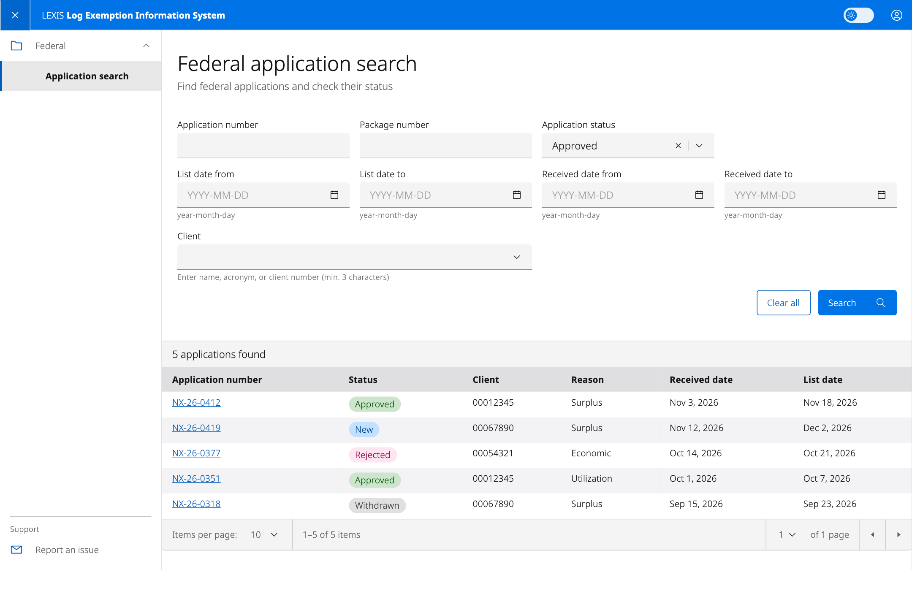

# 6. Federal applications

*For users with the Federal Read Only role.*

Federal applications are not entered in LEXIS. They arrive from the federal
export system (NEXCOL) and are reviewed by ministry staff. With the Federal
Read Only role you can find and read every federal application. You can't
change anything, and you don't see the Provincial menu.

A Business BCeID account holds either Provincial Submitter or Federal Read
Only, never both.

## Screens

| Menu item | Use it to |
|---|---|
| **Federal › Application search** | Find federal applications and check their status. This is the page you land on after logging in. |

## Common tasks

### Find a federal application

1. **Federal › Application search**.
2. Fill in any of:
   - **Application number**: the NEXCOL reference, with or without its
     hyphen;
   - **Package number**;
   - **Application status**, which starts on **Approved**. Choose **All** to
     search every status;
   - the list date or received date range;
   - **Client**: type a client number, name or acronym. It matches the owner
     or the agent.
3. Select **Search**. The newest received applications are listed first.

The results show **Application number**, **Status**, **Client**, **Reason**,
**Received date** and **List date**. Select the application number to open
the record.

### Read a federal application

The record title is the federal application number, with its status beside
it. The tabs are:

| Tab | Shows |
|---|---|
| **Applicant** | The applicant's contact name, client, location, address, phone and email. |
| **Agent** | The agent's details. Only shown when the application was made by an agent. |
| **Application** | Region, product type, application, received and list dates, status and author. |
| **Items** | Location of logs, age class, volumes, species and end use, the packages and each package's summary of scale. |

Select the **Federal application search** link above the title to go back to
your results.
