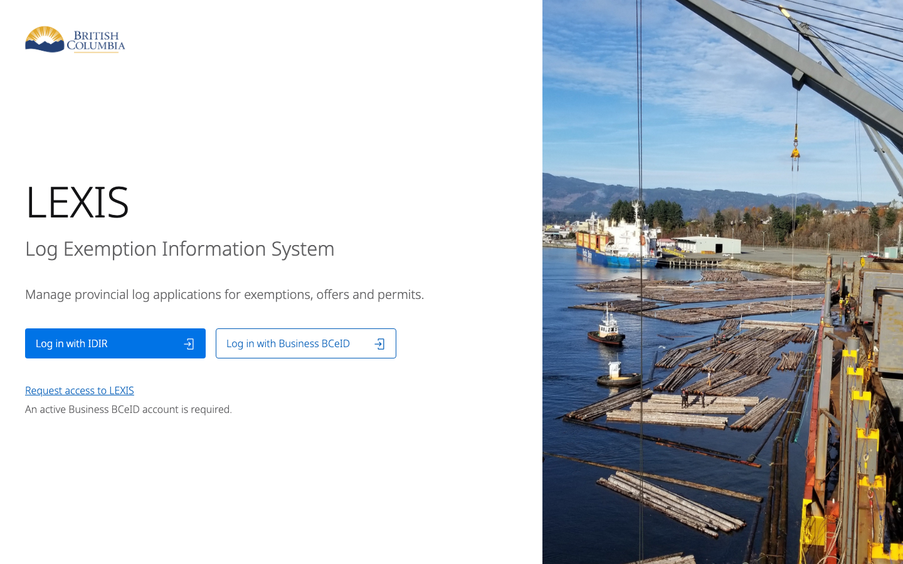
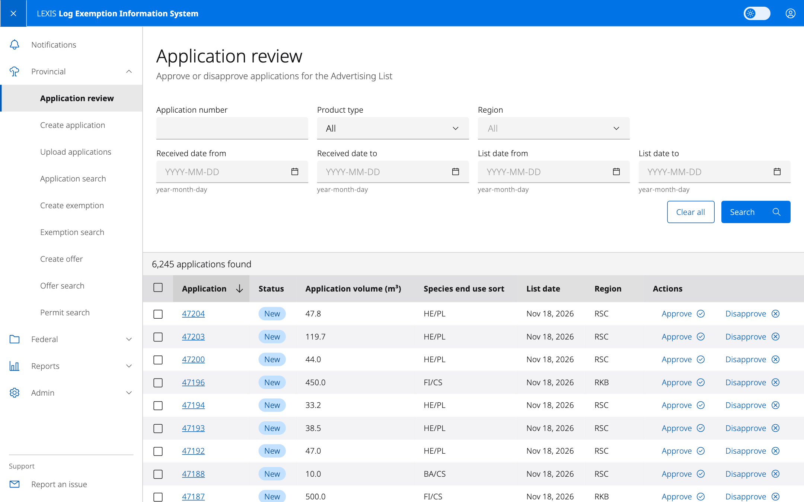
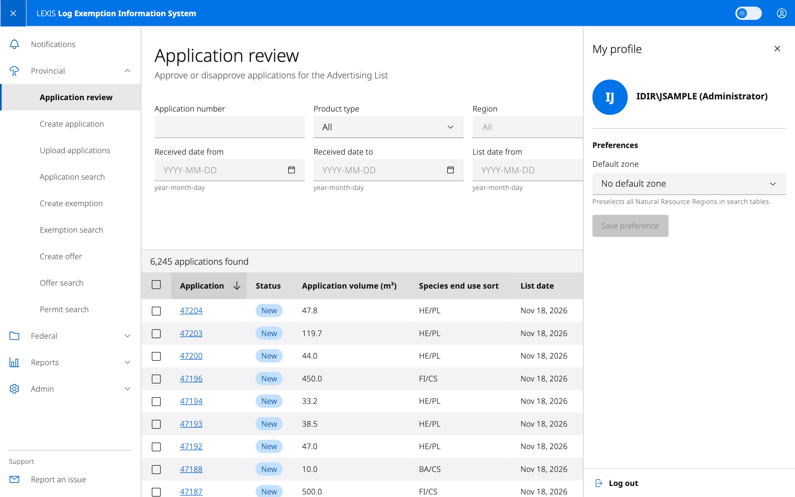

# 1. Getting started

## Logging in

1. Open LEXIS and select **Log in with IDIR**.
2. Sign in on the BC Government page.

Your access comes from the LEXIS role and regions granted to you in FAM
(Forest Access Management). See [Who can do what](09-who-can-do-what.md).

If LEXIS says **Access not granted** after you sign in, you have no LEXIS
role yet. If the message also tells you to contact your administrator, you
hold both Application Approver and Exemption Approver. The two can't be held
together, and one must be removed in FAM before you can use LEXIS.

## Your landing page

LEXIS opens on the page your role uses most.

| Role | Opens on |
|---|---|
| Administrator, Application Approver | **Provincial › Application review** | <!-- roles: administrator, application-approver -->
| Read Only | **Provincial › Application search** | <!-- roles: read-only -->
| Exemption Approver | **Provincial › Exemption search** | <!-- roles: exemption-approver -->

If you followed a link to a record before logging in, LEXIS opens that
record instead. **LEXIS** in the header always takes you back to your
landing page.

## Finding your way around

The left-hand menu groups the screens your role grants.

| Group | Items |
|---|---|
| **Notifications** | Notices from LEXIS administrators. A dot on the bell means there is an active notice. |
| **Provincial** | **Application review**, **Create application**, **Upload applications**, **Application search**, **Create exemption**, **Exemption search**, **Create offer**, **Offer search**, **Permit search** | <!-- roles: administrator, application-approver -->
| **Provincial** | **Application search**, **Exemption search**, **Offer search**, **Permit search** | <!-- roles: read-only -->
| **Provincial** | **Exemption search** | <!-- roles: exemption-approver -->
| **Federal** | **Application search** | <!-- roles: administrator, application-approver, read-only -->
| **Reports** | **Advertising list**, **Offers report**, **Permits report**, **Transport report**, **Species and grade report**, **Tenure analysis report** | <!-- roles: administrator, application-approver, read-only -->
| **Admin** | **Multiplication Factor**, **Non-appraised Sec.3 FIL%**, **Average market values** | <!-- roles: administrator -->

 <!-- roles: administrator, application-approver -->

Select a group heading to open or close it. Select the menu button at the
top left to collapse the menu to icons or open it again. The switch beside
your profile turns the dark theme on and off.

<!-- roles: administrator, application-approver -->
Permits have no "create" menu item: a permit is started from the exemption
it is issued against.
<!-- /roles -->

If you open a link to a page your role doesn't allow, LEXIS says **You
don't have access to view this page** and offers **Go to my landing page**.

Under **Support**, at the bottom of the menu, **User manual** downloads this
manual and **Report an issue** starts an email to the LEXIS support team. If
you hold more than one role, there is a manual for each.

## Your profile and default zone

Select the person icon in the header to open **My profile**. It shows your
user ID, your role and your organization unit, with **Log out** below.

Administrators, and staff granted all eight Natural Resource Regions, also
see **Preferences › Default zone**. It preselects the **Region** filter on
the provincial search screens.

<!-- roles: administrator, application-approver -->
It also preselects **Region** on **Application review**.
<!-- /roles -->

| Default zone | Preselects |
|---|---|
| **No default zone** | All regions |
| **Coast (RCO)** | South Coast and West Coast |
| **Northern Interior (RNI)** | Northeast, Omineca and Skeena |
| **Southern Interior (RSI)** | Cariboo, Kootenay-Boundary and Thompson-Okanagan |

Choose a zone and select **Save preference**. The zone is only a starting
point: you can change the **Region** filter on any search.

## Searching

The search screens work the same way.

1. Fill in the filters you need. They are all optional.
2. Select **Search**, or press Enter. Nothing is searched until you do.
3. The number of records found shows above the results. Select a column
   heading to sort, where the heading allows it. Use the pager under the
   table to change page or show 10, 25, 50, 100 or 200 rows.
4. Select the number in the first column to open the record.

**Clear all** empties the filters and the results, and puts **Region** back
to your default zone.

- **Region** lists only the regions you were granted. Leave it on **All** to
  search every one of them.
- **Client** fields find a forest client by name, acronym or client number.
  Type at least three characters and choose from the list.
- Dates are typed or picked as year-month-day, for example `2026-09-28`.

When you open a record from a search, the **Back to** link above its title
returns you to the same results. Your search is also kept if you reload the
page or use the browser's Back button. It is not kept after you log out.

<!-- roles: administrator, application-approver -->
**Application review** is the exception: it opens with its queue already
listed.
<!-- /roles -->

## Working with records

An application, offer, exemption or permit opens as a record with sections
or tabs.

<!-- roles: administrator, application-approver, exemption-approver -->
- A record opens for reading. Select the edit button on a card, for
  example **Edit application details** or **Edit offer**, to change it,
  then **Save changes** or **Cancel**. You edit one card at a time.
- An edit button appears only when your role, your regions and the
  record's status all allow the change. A record outside your regions opens
  for reading only.
- Fields marked with a red asterisk (`*`) are required.
- A message under a field tells you what to correct. Nothing is saved until
  every message is cleared.
- Empty values show as a dash.

If you move to another page with unsaved changes, LEXIS asks **Discard
changes?** Select **Keep editing** to stay.

> **If someone else changed the record first**, LEXIS tells you the record
> was updated and your changes were not saved. Select **Refresh** to load the
> latest version, then make your change again.
<!-- /roles -->

<!-- roles: read-only -->
- A record opens for reading. The Read Only role can't change records.
- Empty values show as a dash.
<!-- /roles -->

<!-- roles: administrator, application-approver -->
## Adding documents to a record

Applications, exemptions and permits each have a **Documents** tab. A
document stays with the record as it moves from application to exemption to
permit. The **Type** column shows where it was added.

1. Open the **Documents** tab and select **Add documents**.
2. Drag files onto the panel, or select it to choose them. You can add
   several at once.
3. LEXIS checks each file, including a virus scan. A file that fails shows
   the reason: remove it and try another copy.
4. Add a **Description** for each file if its name doesn't make clear what
   it is (up to 250 characters).
5. Select **Save documents**.

Accepted file types are BMP, CSV, DOC, DOCX, JPG, PDF, PNG, RTF, TXT, XLS,
XLSX, XML and ZIP, up to 20 MB each.

In the list, **Open** shows a PDF, image or text file in a new tab,
**Download** saves a copy and **Delete** removes the document. You can
delete a document while the record's status allows it (see each chapter).
<!-- /roles -->

<!-- roles: read-only, exemption-approver -->
## Documents on a record

Each record has a **Documents** tab. A document stays with the record as it
moves from application to exemption to permit. The **Type** column shows
where it was added.

In the list, **Open** shows a PDF, image or text file in a new tab and
**Download** saves a copy. Your role can't add or delete documents.
<!-- /roles -->

## Session time-out

After **25 minutes** without activity you are logged out. A warning with a
countdown appears **5 minutes** before that. Select **Stay logged in** to
continue.

Unsaved changes are lost when you are logged out, so save your work before
you step away.

## Logging out

Open your profile and select **Log out**. LEXIS doesn't ask about unsaved
changes when you log out.
