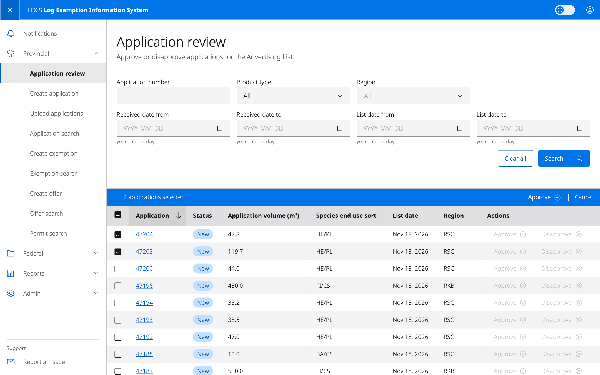
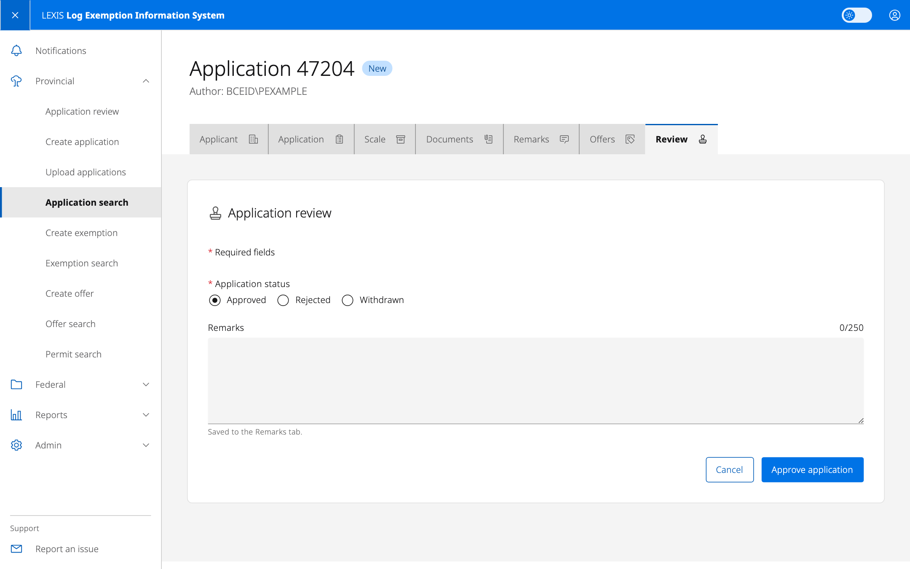

# 2. Applications

Applications for exemption arrive from industry users, on screen or by file
upload. Staff review them for the Advertising List on their list date, and
can enter or correct an application for a client.

| Role | Can |
|---|---|
| Application Approver, Administrator | Review, create, upload and change applications, add remarks. An Application Approver works in their regions. | <!-- roles: administrator, application-approver -->
| Read Only | Find and open applications in their regions and read the remarks. | <!-- roles: read-only -->
| Exemption Approver | Open an application linked from an exemption. On a Ministerial exemption with volume remaining, edit or delete its packages and add or delete scale lines. No search, remarks or review. | <!-- roles: exemption-approver -->

<!-- roles: administrator, application-approver, read-only -->
## Screens

| Menu item | Use it to |
|---|---|
| **Provincial › Application review** | Approve or disapprove New applications for the Advertising List. | <!-- roles: administrator, application-approver -->
| **Provincial › Create application** | Enter an application for a client. | <!-- roles: administrator, application-approver -->
| **Provincial › Upload applications** | Create applications from files. | <!-- roles: administrator, application-approver -->
| **Provincial › Application search** | Find provincial applications, and start an exemption from approved ones. | <!-- roles: administrator, application-approver -->
| **Provincial › Application search** | Find provincial applications. | <!-- roles: read-only -->
<!-- /roles -->

## Application statuses

| Status | What it means |
|---|---|
| **New** | Waiting for review. Listed in **Application review**. |
| **Approved** | Approved for advertising on its list date. |
| **Rejected**, **Withdrawn** | Disapproved, with a remark giving the reason. |
| **Exempted** | Linked to an exemption. Search results show **Exempted - New** until the exemption is approved. |
| **Permitted** | Included on a permit. |
| **Expired** | Set overnight when the application's exemption expires. |

## Common tasks

<!-- roles: administrator, application-approver -->
### Review applications for the Advertising List

1. **Provincial › Application review**. The queue opens with every New
   application in your regions, 100 to a page.
2. Narrow it with **Application number**, **Product type**, **Region**,
   or the received date or list date range, and select **Search**.
3. Select the number in the **Application** column to check an application,
   then use the link above its title to come back.
4. Approve or disapprove:
   - **Approve** on a row approves that application at once.
   - To approve several, tick them and select **Approve** in the bar above
     the table, then confirm the list.
   - **Disapprove** on a row opens the disapproval dialog.

Approved and disapproved applications leave the queue. No email is sent on
approval.

An information icon beside an application number means the application
holds timber marks from MU44.

If an application can't be approved, it stays in its status and the reason
is listed above the table, for example a missing owner location, species
and end use that are not valid for the region, or package volumes larger
than the application volume. Correct the application and approve it again.

### Disapprove an application

1. Select **Disapprove** on the row.
2. Choose the **Application status**: **Rejected** or **Withdrawn**.
3. Enter the **Remark** (up to 250 characters). It is included in the email
   to the applicant and saved on the application's **Remarks** tab.
4. **Send disapproval email** starts ticked. Clear the tick to disapprove
   without an email. The **Owner email**, and the **Agent email** when the
   applicant is an agent, come from their client locations. Select **Edit
   recipients** to change an address for this email only. If no address is
   on file, type one.
5. Select **Disapprove and send email**, or **Disapprove application** when
   the tick is cleared.

The email goes from the export mailbox for the application's region. Its subject gives the
application number and the new status, and its body is your remark. The
status is saved first: if the email can't be sent, the notice says so and
the application stays disapproved.

### Review from the application record

The **Review** tab on an application does the same job for one application.

1. Open the application and its **Review** tab, and select **Update
   status**.
2. Choose **Approved**, **Rejected** or **Withdrawn**, and add **Remarks**
   if you have any.
3. Select **Approve application**, or **Update status** for the other two,
   which opens the disapproval dialog.

- A **New** application can be approved.
- A **New** or **Approved** application can be rejected or withdrawn. For an
  approved one, only within six days of its list date.

### Move an application to another list date

Open the application's **Application** tab and select **Edit application
details**. Find **List date** below **Application date**. It offers the next two list dates, today's date when
today is a list date, and **No list date**. No email is sent.

### Enter an application for a client

**Provincial › Create application** has the same three tabs the client
fills in, with these differences:

- **Client** is a search. Type at least three characters of the name,
  acronym or client number.
- **Contact name** fills in with the contact on file for the chosen **Client
  location**, and can be changed.
- Tick **I'm an agent** to add **Agent information** for a different client.
- Choose the harvest **Region** before entering the **Advertising details**.
  It determines the species and end uses available. Enter **Average log
  volume (m³)** with a decimal point, for example `1.2`.
- **Advertising list date** also offers today's date, when today is a list
  date, and **No list date**.
- There is no accuracy confirmation. **Save application** saves at once.

The application is saved as **New** and opens with its number.

### Upload applications from files

**Provincial › Upload applications** takes XML, ZIP, GeoJSON or JSON files,
one application to a file, up to 20 MB each. Each file is checked as it is
added. Select **Review**, then **Create … application(s)**. An Application
Approver can upload applications only for their regions. No email is sent.

### Change an application

Select the edit button on the **Applicant details**, **Application
details** or **Advertising details** card.

- A **New** application can be changed at any time.
- An **Approved** application can be changed until six days after its list
  date, or at any time if it has no list date.
- **Rejected**, **Withdrawn** and **Expired** applications can't be changed.
- The owner client can't be changed once the application is saved.
- If a change to the **Species list** rules out the **End use**, **End use** is
  cleared and you choose another.
- If the application volume is larger than the package volumes together,
  saving opens **Confirm application details** with the warning "The sum of
  the package volume is less than the total application volume." Select
  **Save changes** to save anyway.

After the details lock, you can still add or remove the agent on an
application that is on a Ministerial permit, while each of its permits is
Active or Payment pending.
<!-- /roles -->

<!-- roles: administrator, application-approver, exemption-approver -->
### Packages and the summary of scale

On the **Package and scale** tab, choose a package in **Selected package**. Its card
shows **Comments**, or a dash when empty, and its **Summary of scale**.
<!-- /roles -->

<!-- roles: administrator, application-approver -->
1. Select **Create package** and enter the **Package number** (unique, up
   to 20 characters), **Volume (m³)**, **Average length (m)** and **Average
   top diameter (rads)**. Select **Save package**.
2. Under **Summary of scale**, select **Add scale** for each line: **Timber
   mark**, **Pieces**, **Species**, **Grade** and **Volume (m³)**. Select
   **Save scale**. LEXIS capitalizes the timber mark as you type. Choose
   the grade by its code.
<!-- /roles -->

<!-- roles: exemption-approver -->
Open the application from the exemption's **Applications** tab. While the
exemption is Ministerial and has volume remaining, you can edit or delete a
package and add or delete its scale lines.
<!-- /roles -->

<!-- roles: administrator, application-approver, exemption-approver -->
| Rule | Detail |
|---|---|
| Package volume | The packages together can't be more than the application volume. |
| Scale volume | The scale lines together can't be more than their package's volume. |
| Timber mark | Must be valid for the application's region. |
| Scale lines | A package can hold one line for each combination of timber mark, species and grade. To correct a line, delete it and add it again. |

- Packages and scale lines can be changed until the application is on a
  completed permit.
- A package with a scale line on a completed permit can't be edited, and
  that scale line has no **Delete**.
- **Delete package** is offered only for a package with no scale lines.
- The **Scale type** column shows **C** for coast scale and **I** for
  interior scale.
<!-- /roles -->

<!-- roles: administrator, application-approver -->
A package can be renamed while the application is New, or Approved within
six days of its list date.
<!-- /roles -->

<!-- roles: administrator, application-approver, read-only -->
### Remarks

The **Remarks** tab lists each remark with its date, time and user. Only
staff see it. Remarks entered when disapproving an application appear here
too.
<!-- /roles -->

<!-- roles: administrator, application-approver -->
Select **Add remark** while the application's details can be changed, or
**Edit** on a saved remark at any time before the application expires. A
remark holds up to 250 characters.
<!-- /roles -->

<!-- roles: read-only -->
The Read Only role can't add or edit remarks.
<!-- /roles -->

<!-- roles: administrator, application-approver, read-only -->
### Find applications

**Provincial › Application search** filters by **Application number**,
**Package number**, **Exemption number**, **Region**, the list date range,
**Exemption type**, **Application status**, **Owner client**, **Agent
client** and **Product type**. Federal applications are under **Federal ›
Application search**.
<!-- /roles -->

<!-- roles: administrator, application-approver -->
To start a Ministerial exemption, tick approved applications in the results
and select **Create exemption**. See [Exemptions](04-exemptions.md).
<!-- /roles -->

### Documents

<!-- roles: administrator, application-approver -->
Add documents from the application's **Documents** tab. You can delete a
document at any status. See [Getting started](01-getting-started.md).
<!-- /roles -->

<!-- roles: read-only, exemption-approver -->
Open and download documents from the application's **Documents** tab. See
[Getting started](01-getting-started.md).
<!-- /roles -->
