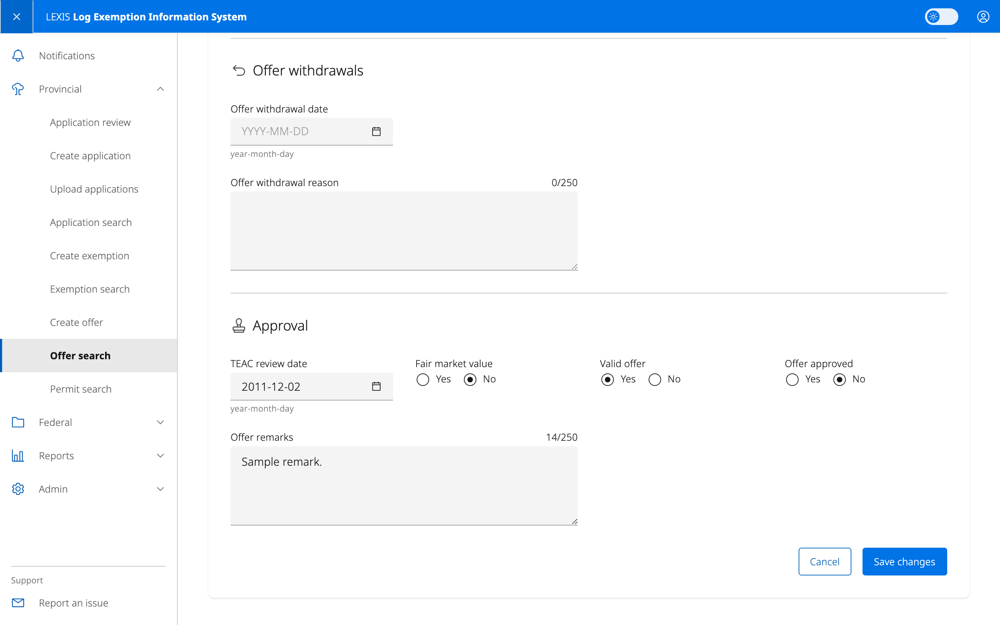

# 3. Offers <!-- roles: administrator, application-approver, read-only -->

Companies offer to buy timber advertised on the Advertising List. Industry
users place and withdraw their own offers. Staff enter offers for companies
that ask, record the Timber Export Advisory Committee (TEAC) review and the
decision, and withdraw offers for clients after the client deadline.

| Role | Can |
|---|---|
| Application Approver, Administrator | Find, open, create and change offers. An Application Approver changes offers only on applications in their regions. | <!-- roles: administrator, application-approver -->
| Read Only | Find and open offers. | <!-- roles: read-only -->

## Screens

| Menu item | Use it to |
|---|---|
| **Provincial › Create offer** | Enter an offer for a company. | <!-- roles: administrator, application-approver -->
| **Provincial › Offer search** | Find offers by application, package, region, list date, withdrawn date or client. |

## Common tasks

### Find an offer

1. **Provincial › Offer search**.
2. Fill in any of **Application number**, **Package number**, **Region**,
   the list date or withdrawn date range, or **Client**. **Client** matches
   the owner or the agent on the application. There is no offer number
   filter.
3. Select **Search**, then the number in the **Offer** column.

An offer has no status of its own. A filled **Offer withdrawn date** means it
was withdrawn. The decision is in the record's **Approval** section.

<!-- roles: read-only -->
The **Approval** section shows you the three Yes/No answers: **Fair market
value**, **Valid offer** and **Offer approved**.
<!-- /roles -->

<!-- roles: administrator, application-approver -->
### Enter an offer for a company

1. **Provincial › Create offer**.
2. Enter the **Application number**. LEXIS checks that the application is
   provincial, has a status that accepts offers and is inside its offer
   period. If it isn't, the reason shows under the field.
3. If the application has packages, choose the **Package number**. **See
   scale detail** shows the package's summary of scale.
4. Under **Offering company details**, type the **Company** (up to 52
   characters) and the **Contact name**.
5. Under **Offer details**, enter **Offer volume (m³)**, **Offer amount
   ($/m³)**, **Pickup location** and any **Offer conditions/remarks**.
6. Under **Approval**, **TEAC review date** is filled from the schedule.
   **Fair market value** starts at **No**, **Valid offer** at **Yes** and
   **Offer approved** at **No**. Change them now or later.
7. Select **Save offer**. The new offer record opens with its number in the
   title.

LEXIS emails the applicant (the agent, when the application has one) and
copies the regional office mailbox. If the applicant has no email address on
file, the notice on the record says no email was sent, and you need to
contact them another way.

### Record the TEAC review and the decision

1. Open the offer and select **Edit offer**.
2. Under **Approval**, set **TEAC review date**, **Fair market value**,
   **Valid offer** and **Offer approved**, and add **Offer remarks** (up to
   250 characters) if needed.
3. Select **Save changes**.

Changes to the **Approval** section don't send an email. **TEAC review
date** and **Offer remarks** show only to Application Approvers and
Administrators who can change the offer. Industry users and Read Only staff
see the three Yes/No answers.

### Change or withdraw an offer for a client

Industry users can withdraw their own offer until the day before the
schedule's withdrawal deadline. After that they ask the export office.

1. Open the offer and select **Edit offer**.
2. Change the offer details, or under **Offer withdrawals** enter the
   **Offer withdrawal date** and **Offer withdrawal reason**.
3. Select **Save changes**.

LEXIS emails the applicant and the regional office mailbox when the amount,
volume, pickup location, conditions or withdrawal details change. The
company, contact name, application and package can't be changed once the
offer is saved.

If someone else saved the offer after you opened it, LEXIS tells you your
changes were not saved. Select **Refresh** and make your change again.
<!-- /roles -->
