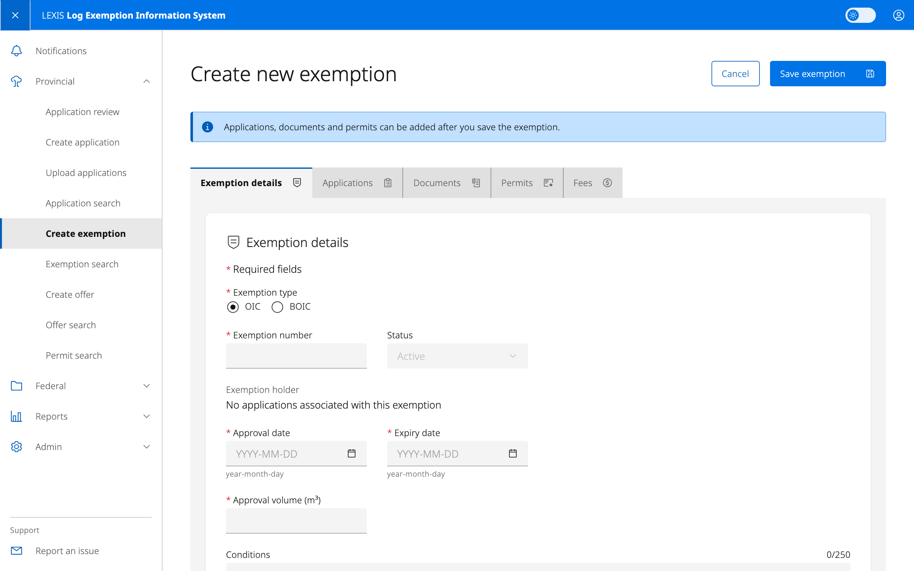

# 4. Exemptions

An exemption authorizes the export of a volume of timber until its expiry
date. Permits are issued against it.

| Type | How it is created | Starts as |
|---|---|---|
| **Ministerial** | From approved applications, in **Application search**. | **New**, until an Exemption Approver or Administrator approves it. |
| **Order in Council** | On **Create exemption**, for a specific applicant. | **Active** | <!-- roles: administrator, application-approver, read-only -->
| **Blanket Order in Council** (Blanket OIC) | On **Create exemption**, for one or more regions. It has no applications. | **Active** | <!-- roles: administrator, application-approver, read-only -->

| Role | Can |
|---|---|
| Application Approver | Create exemptions, change their details, add and remove applications, add and delete documents, start permits. Can't approve a Ministerial exemption. | <!-- roles: application-approver -->
| Exemption Approver | Find, change and approve Ministerial exemptions in their regions. Sees no other exemption type and no **Permits** tab. | <!-- roles: exemption-approver -->
| Read Only | Find and open exemptions in their regions. | <!-- roles: read-only -->
| Administrator | Create, change and approve exemptions province-wide, start permits and use **Print approved exemption**. | <!-- roles: administrator -->

## Exemption statuses

| Status | What it means |
|---|---|
| **New** | A Ministerial exemption waiting for approval. Permits can't be requested. |
| **Active** | Approved. Permits can be requested until the expiry date. |
| **Cancelled** | Cancelled by staff. Its applications that were still Exempted go back to Approved. |
| **Expired** | Set overnight after the expiry date. Its applications and permits are set to Expired with it. The record becomes read-only, except that documents can still be added. |

## Screens

| Menu item | Use it to |
|---|---|
| **Provincial › Create exemption** | Create an Order in Council or Blanket OIC exemption. | <!-- roles: administrator, application-approver -->
| **Provincial › Exemption search** | Find exemptions, and approve Ministerial ones. | <!-- roles: administrator, exemption-approver -->
| **Provincial › Exemption search** | Find exemptions. | <!-- roles: application-approver, read-only -->
| **Provincial › Application search** | Create a Ministerial exemption from approved applications. | <!-- roles: administrator, application-approver -->

## Common tasks

### Find an exemption

**Provincial › Exemption search** filters by **Exemption number**,
**Application number**, **Package number**, **Region**, the list date range,
**Exemption type**, **Exemption status**, **Owner client** and **Agent
client**. A list date range finds an exemption when any of its applications
is listed in that range; the results show its latest list date. Blanket OIC
and OIC exemptions have no list date, so a list date search leaves them out.
Select the number in the first column to
open the exemption. Its **Applications** tab lists the applications it
covers: select a number to open one.

<!-- roles: administrator, application-approver -->
### Create a Ministerial exemption

1. **Provincial › Application search**. Search for the approved
   applications.
2. Tick the applications to include. They must have the same owner and
   agent. A row that can't be ticked explains why when you point at it: the
   application must be approved, have no exemption and no valid offer, and
   its list date must have passed unless it is standing timber.
3. Select **Create exemption** in the bar above the results, then confirm
   with **Create exemption**.

LEXIS assigns the exemption number and opens the new exemption as **New**.
Its approval volume is the applications' total volume, and its expiry date
is today plus the longest application term, at least 30 days. The
applications become **Exempted**.

### Create an Order in Council or Blanket OIC exemption

1. **Provincial › Create exemption**.
2. Choose the **Exemption type**: **OIC** for an Order in Council exemption,
   or **BOIC** for a Blanket OIC.
3. Enter the **Exemption number** (up to 8 characters). LEXIS checks that it
   isn't already used.
4. Enter the **Approval date**, **Expiry date** and **Approval volume
   (m³)**. For a Blanket OIC, also choose its **Region**, one or more.
5. Add **Conditions** if there are any (up to 250 characters).
6. On the **Fees** tab, set **Override fee rate?** to **Yes** and enter the
   **Fee rate ($/m³)** if the exemption fixes the fee.
7. Select **Save exemption**. The exemption is saved as **Active**.

Applications, documents and permits are added after the exemption is saved.

### Add or remove an exemption's applications

*Not for Blanket OIC exemptions.*

1. Open the exemption's **Applications** tab and select **Add
   application**.
2. Enter the **Application number** and select **Save application**.

The application must be approved, not on another exemption, and without a
valid offer. On a Ministerial exemption it must belong to the same owner
and its list date must have passed, and it can't take an **Active**
exemption over its approval volume.

**Remove** is offered on an application that isn't on a permit. The
application goes back to **Approved**. A regional Application Approver needs
every region the exemption covers, and the application's region.
<!-- /roles -->

<!-- roles: administrator, application-approver, exemption-approver -->
### Change an exemption

Select **Edit exemption details** on the **Exemption details** tab. You
need every region the exemption covers.

- **Status**: set a New or Active exemption to **Cancelled**, or reopen a
  cancelled one. A cancelled Ministerial exemption reopens as **New** or
  **Active**, and a cancelled Order in Council as **Active**. A cancelled
  Blanket OIC can't be reopened.
- **Exemption type**: a Ministerial exemption can be changed to Order in
  Council. No other change of type is possible.
- **Expiry date**: while the exemption is **New**, or for a Blanket OIC
  while it is New or Active.
- **Approval volume (m³)** and **Conditions**: until the exemption is
  cancelled or expired.

A **New** Ministerial exemption can't be made Active here. It has to be
approved. **Expired** is never chosen by hand.

The fee rate is on the **Fees** tab under **Edit fee override**. For a
Ministerial exemption it can change only while the exemption is New.
<!-- /roles -->

<!-- roles: administrator, exemption-approver -->
### Approve a Ministerial exemption

1. Open the **New** exemption and select **Approve exemption**. Or, in
   **Provincial › Exemption search**, tick one or more New Ministerial
   exemptions and select **Approve**.
2. Tick **I certify that this exemption has been approved**.
3. **Send approval email** starts ticked. The **Owner email**, and the
   **Agent email** when the applicant is an agent, come from their client
   locations. Select **Edit recipients** to change an address for this
   approval only, or clear the tick to approve without an email.
4. Select **Approve and send email**, or **Approve exemption**.

The exemption becomes **Active** with today's date as its approval date.
The email goes from the export mailbox for the region of the exemption's
first application. It gives the exemption
number and lists its application numbers, and its text can't be changed.

An exemption is not approved, and stays **New**, if it has no application,
if its approval volume is less than the total requested volume, or if its
expiry date is missing or already past. If the approval volume is too
low, the message gives the total requested volume. Enter at least that
amount in **Approval volume (m³)** and approve again. You need every region the exemption covers.
<!-- /roles -->

<!-- roles: exemption-approver -->
Your **Exemption search** starts on Ministerial exemptions with status New.
<!-- /roles -->

<!-- roles: administrator -->
### Print the approved exemption

Select **Print approved exemption** at the top of an **Active** exemption.
The report opens as a PDF in a new tab, where you can save or print it.
<!-- /roles -->

<!-- roles: administrator, application-approver -->
### Start a permit

On the **Permits** tab of an **Active** exemption, select **Apply for new
permit**. See [Permits](05-permits.md).
<!-- /roles -->

### Expiry

Each night LEXIS sets exemptions past their expiry date to **Expired**,
together with their applications and permits, and adds a remark to each
application. If you had an exemption open when that happened, your next
save tells you it expired overnight and isn't saved.
