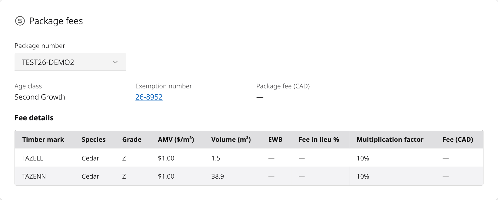
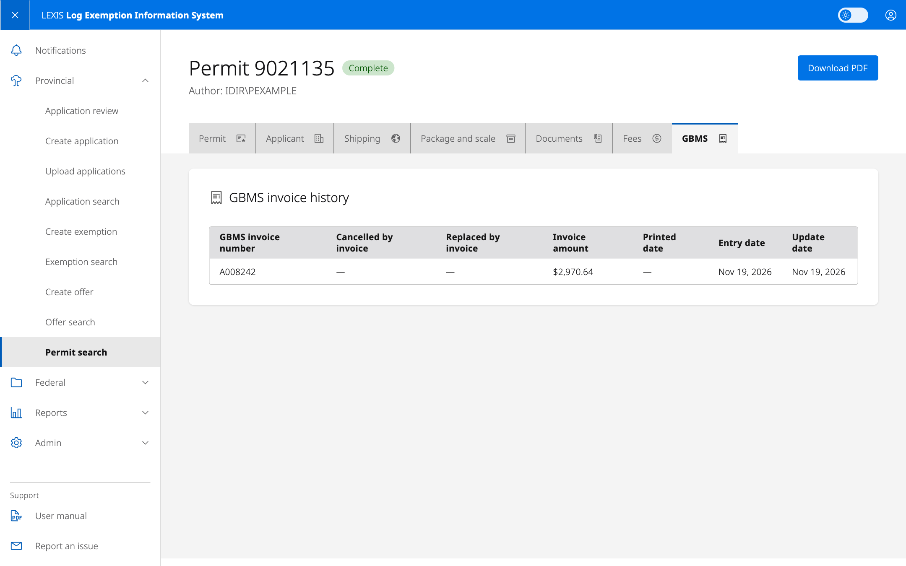

# 5. Permits

A provincial permit allows timber under an Active exemption to be shipped.
Industry users request permits and send them for review. Staff check the
request, confirm the fee in lieu of manufacture, complete the permit and
notify the applicant. Completing a permit creates its invoice.

| Role | Can |
|---|---|
| Application Approver, Administrator | Start, change, complete, cancel and reactivate permits, override fees, enter receipt numbers. An Application Approver works in their regions. |
| Read Only | Find and open permits in their regions, open documents and print completed permits. |
| Exemption Approver | No access to permits. |

## Permit statuses

| Status | What it means |
|---|---|
| **Active** | A request that is not issued yet. The number shows **(Pending)** beside it. |
| **Payment pending** | An interior permit completed without a receipt number. Set automatically. |
| **Complete** | Issued and invoiced. It can be printed. |
| **Cancelled** | Cancelled. Its invoices are cancelled with it. |
| **Expired** | Set overnight when the permit's exemption expires, or by staff. Read-only after that, except for documents. |

## Screens

| Menu item | Use it to |
|---|---|
| **Provincial › Permit search** | Find permits by application, package or permit number, region, issued date, status, owner client or agent client. |
| **Provincial › Exemption search** | Open the exemption to start a new permit. |

A permit record has these tabs: **Permit**, **Applicant**, **Shipping**,
**Scale**, **Documents**, **Fees** and, once the permit has invoice
history, **GBMS**.

## Common tasks

### Find permit requests waiting for review

When a client selects **Email review request**, LEXIS emails your regional
mailbox with the permit number. To list requests, use **Provincial › Permit
search** with **Permit status** set to **Active**, and your **Region**.
Active permits show **(Pending)** beside the number.

### Start a permit for a client

Open the **Active** exemption's **Permits** tab and select **Apply for new
permit**.

- **Ministerial**: select **Create permit**. The permit is created empty.
  In **Edit permit details**, tick **Include in permit** for each
  application to put on it.
- **Order in Council**: select **Create permit**. Every eligible scale line
  from the exemption's applications is added. The permit is refused if that
  volume is more than the exemption's balance remaining.
- **Blanket OIC**: select **Continue** and fill in the **Apply for new
  permit** form. Staff choose the owner with the **Client** search and can
  set the submit, issued and expiry dates. Packages and scale are added on
  the saved permit's **Scale** tab.

A permit can't be deleted once it is created.

### Review a permit request

Open the permit and check each tab.

| Tab | Check |
|---|---|
| **Permit** | The exemption, the region, the applications on the permit, **Current permit pieces** and **Current permit volume (m³)** against **Total volume remaining (m³)**. For a Blanket OIC, the request pieces and volume. |
| **Applicant** | The owner and agent. The **Client location** decides where the invoice goes. |
| **Shipping** | Purchaser, final destination country, transport, estimated shipping date and customs port of export. |
| **Scale** | Each package and its summary of scale. |
| **Documents** | The documents your office requires. |
| **Fees** | The fee for each scale line and the totals. |

Each card has its own edit button, for example **Edit shipping details**.
You can correct the client's entries while the permit is **Active**.

> **Order in Council permits** use an older layout. The **Permit** tab has a
> **Permit summary** card with **Edit permit** and **Save permit**, the
> **Shipping** tab has **Edit shipping**, and the receipt number is changed
> with **Edit permit** on the **Fees** tab. Where the steps below say **Edit
> permit details** and **Save changes**, use those buttons instead.

### Check and override the fee

**Permit fees** shows **Total volume (m³)** and **Total fees (CAD)**.
**Package fees** shows each scale line with its **AMV ($/m³)**, volume,
**EWB**, **FIL**, **MF** and **Fee (CAD)**.

In outline, LEXIS works out the fee for each scale line:

- at the exemption's fixed rate, when the exemption sets one;
- for coastal timber, from the average market value for the species and
  grade and the fee in lieu percentage, plus the multiplication factor for
  the region where one applies;
- at $1 per cubic metre for interior timber.

A permit with a Canadian destination shows no fee amount. The average
market values, multiplication factors and fee in lieu percentage are set by
an Administrator. See [Administration](08-administration.md).

To replace the calculated total, select **Edit fee override**, set
**Override fees?** to **Yes**, and enter the **Override fee (CAD)** and an
**Override comment**. The override can be changed only while the permit is
**Active**.

For an interior permit, select **Edit receipt number** to record the
prepaid fee receipt.

### Complete a permit

1. On the **Permit** tab, select **Edit permit details**.
2. Set **Status** to **Complete**.
3. Enter the **Issued date** and check the **Expiry date**. A Ministerial
   permit can't expire after its exemption.
4. Select **Save changes**.
5. In **Email permit … approval?**, check the **Applicant email address**
   and select **Send approval**, or close the dialog to skip the email.

To be completed, a permit needs at least one application, package and
scale line, a submit date that isn't in the future, and an issued date on
or after it. A Blanket OIC permit also needs request pieces and volume
above zero.

Completing the permit creates its invoice and fixes its volume and pieces.
If the invoice can't be created, nothing is saved and the permit stays as
it was. An application becomes **Permitted** when it is added to a
Ministerial permit, or when its Order in Council permit is completed.

> **Interior permits without a receipt:** LEXIS asks **Save as Payment
> pending?** Select **Save** and the permit becomes **Payment pending**
> instead of Complete. When payment arrives, enter the receipt number and
> set the status to **Complete**. No approval email is offered until then.

The approval email goes from the export mailbox for the permit's region to
the address you confirm. It gives the permit number and lists its packages.

### Cancel, reactivate or replace a permit

Change the **Status** in **Edit permit details**.

- **Cancelled** cancels every active invoice for the permit. Its Permitted
  applications normally go back to **Exempted**. Shipping and documents can
  still be changed on a cancelled permit, except the port of export.
- **Active**, from Complete, Payment pending or Cancelled, also cancels the
  active invoices and reopens the permit for changes.
- To replace an issued permit, set it back to **Active**, make the
  correction and complete it again. The new invoice replaces the earlier
  one.

### Follow the invoices

The **GBMS** tab lists the permit's invoice history: **GBMS invoice
number**, **Cancelled by invoice**, **Replaced by invoice**, **Invoice
amount**, **Printed date**, **Entry date** and **Update date**. Invoices are
never entered by hand: they follow the permit's status.

### Print a permit

Select **Print permit** at the top of a **Complete** permit. The PDF has
the permit on the first page and the detailed summary by timber mark on the
second.

### What clients can change

- A client can change an **Active** permit and send a new review request.
- On a **Complete** permit a client can still change the shipping details,
  except the port of export, and print the permit again.
- A client can't change the dates, the fee or the receipt number. A client
  can change the status only of a **Payment pending** permit.

### Documents

Add documents from the **Documents** tab. An Administrator can delete a
document at any status. An Application Approver can delete one while the
permit is **Active** or **Expired**.
