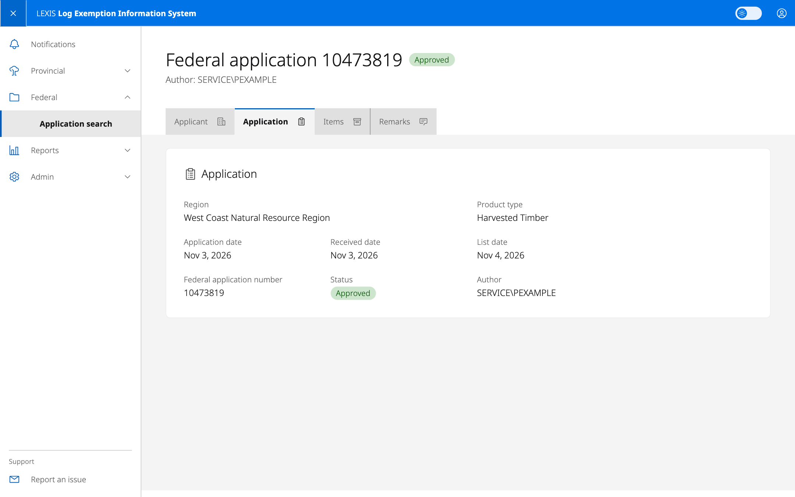

# 6. Federal applications <!-- roles: administrator, application-approver, read-only -->

<!-- roles: administrator, application-approver -->
Federal applications are not entered in LEXIS. The federal export system
(NEXCOL) submits them, and they appear in LEXIS as records you can read,
remark on and, in a few cases, reject or withdraw. They are approved for
advertising from **Provincial › Application review**, together with
provincial applications (see [Applications](02-applications.md)).
<!-- /roles -->

<!-- roles: read-only -->
Federal applications are not entered in LEXIS. The federal export system
(NEXCOL) submits them, and they appear in LEXIS as records you can read.
<!-- /roles -->

| Role | Can |
|---|---|
| Application Approver, Administrator | Find and open federal applications, add and edit remarks, and reject or withdraw an approved application through its list date. An Application Approver does this only in their regions. | <!-- roles: administrator, application-approver -->
| Read Only | Find and open federal applications in their regions and read the remarks. | <!-- roles: read-only -->

## Screens

| Menu item | Use it to |
|---|---|
| **Federal › Application search** | Find federal applications and check their status. |

## Common tasks

### Find a federal application

1. **Federal › Application search**.
2. Fill in any of **Application number** (the NEXCOL reference, with or
   without its hyphen), **Package number**, **Application status**, the
   list date or received date range, or **Client**. **Application status**
   starts on **Approved**; choose **All** for every status.
3. Select **Search**. The newest received applications are listed first.

Regional staff see applications in their regions only.

### Read a federal application

Select the application number in the results. The record has these tabs:

| Tab | Shows |
|---|---|
| **Applicant** | Contact name, applicant type, client, location, address, phone and email. |
| **Agent** | The agent's details, when the application was made by an agent. |
| **Application** | Region, product type, application, received and list dates, federal application number, status and author. |
| **Items** | Location of logs, age class, volumes, species and end use, the packages and each package's summary of scale. |
| **Remarks** | Each remark with its date, time and user. |

<!-- roles: administrator, application-approver -->
### Add or change a remark

1. Open the **Remarks** tab.
2. Select **Add remark**, or **Edit** beside an existing remark.
3. Type the remark (up to 250 characters) and select **Save remark** or
   **Update remark**.

### Reject or withdraw an approved application

**Withdraw** and **Reject** appear on the **Application** tab only while the
application is **Approved** and today is on or before its **List date**.

1. On the **Application** tab, select **Withdraw** or **Reject**.
2. In **Update federal status**, enter a **Remark** (required, up to 250
   characters).
3. Select **Update status**.

The status changes on the record straight away. An application that is not
yet approved is approved, rejected or withdrawn from **Provincial ›
Application review** instead.

### If someone else changed the application

If someone else saved the application after you opened it, LEXIS tells you
your change was not saved. Select **Refresh** and make your change again.
<!-- /roles -->
