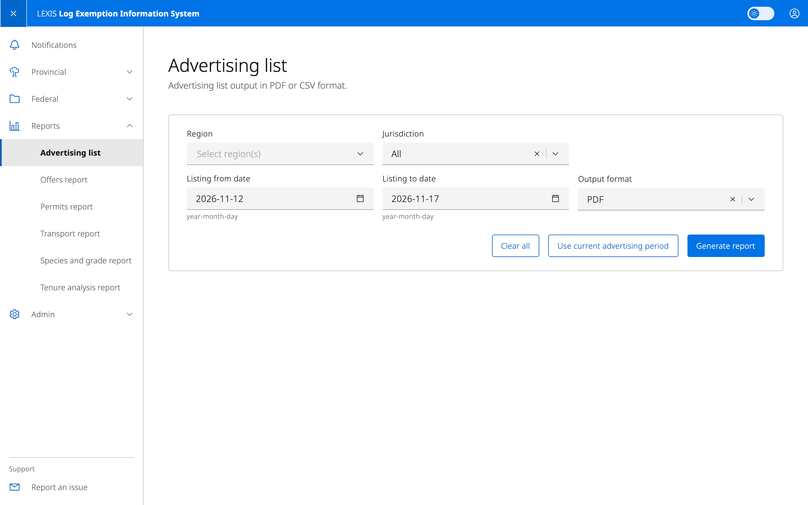

# 7. Reports <!-- roles: administrator, application-approver, read-only -->

Each report is a page of options and a **Generate report** button. A PDF
report opens in a new browser tab, where you can read, save or print it. A CSV
or XLS report downloads as a file.

## Screens

| Menu item | Produces | Formats |
|---|---|---|
| **Reports › Advertising list** | Approved applications by list date, for the published Advertising List. | PDF, CSV |
| **Reports › Offers report** | Offers by application, with TEAC date, fair and valid offer answers and withdrawals. | PDF, CSV |
| **Reports › Permits report** | A permit ledger: volume by species for each permit, with destination country and client. | PDF, CSV |
| **Reports › Transport report** | Permits by port of export, vessel and shipment date, with totals by transport method and region. | PDF, CSV |
| **Reports › Species and grade report** | Permit volumes by species and grade. | PDF, CSV |
| **Reports › Tenure analysis report** | Permit volumes by tenure, timber mark and exemption. | PDF, XLS |

## Common tasks

### Run a report

1. Choose the report from the **Reports** menu.
2. Fill in the options you need. Most are optional: an empty option means
   "all".
3. Choose the **Output format**.
4. Select **Generate report**. A PDF opens in a new tab when it is ready. A
   CSV or XLS file downloads, and a notice says the report was downloaded.

> **Tip:** If a PDF report doesn't open, your browser has blocked the new
> tab. Allow pop-ups for LEXIS from the browser's address bar, then generate
> the report again.

**Clear all** empties the options. If nothing matches, LEXIS says **No
report data matched the selected criteria** and no file is produced.

<!-- roles: application-approver, read-only -->
> **Regions:** the **Region** list holds your regions only. Leave it empty
> to report on all of your regions.
<!-- /roles -->

### Advertising list

Options: **Region**, **Jurisdiction**, **Listing from date**, **Listing to
date**.

**Use current advertising period** fills the two dates with the current
advertising period. The list holds approved applications only. The
published lists and the Export Schedule are on
[Weekly Advertising Lists](https://www2.gov.bc.ca/gov/content?id=EEC95AA8942A4E3BA7A71C707E6F2BF5).

### Offers report

Options: **Region**, **Jurisdiction**, **Client number**, **Application
from date** and **Application to date**, **Withdrawn from date** and
**Withdrawn to date**.

### Permits report

Options: **Region**, **Client number**, **Exemption number**, **Exemption
type**, **Exemption reason**, **Permit status**, **Growth type**, **Timber
mark**, **Final destination country**, **Issued from date** and **Issued to
date**.

**Final destination country** lists the most common countries. Select
**More...** for the full list.

### Transport report

Options: **Jurisdiction**, **Region**, **Final destination country**,
**Customs port of export**, **Permit status**, **Permit issued from date**
and **Permit issued to date**.

### Species and grade report

Options: **Region**, **Permit status**, **Exemption number**, **Exemption
type**, **Exemption reason**, **Growth type**, **Timber mark**, **Forest
file ID**, **Permit issued from date** and **Permit issued to date**.

**Permit status** starts on completed permits. Enter a **Timber mark** or a
**Forest file ID**, not both: typing one disables the other.

### Tenure analysis report

Choose a **Report variant** first. The options change with it.

| Report variant | Options |
|---|---|
| **Permit details report** | **Region**, **Exemption number**, **Exemption type**, **Client number**, **Forest file ID**, **Exemption reason**, **Client type** (**Permit holder** or **Mark holder**) |
| **Tenure types report** | **Tenure type 1** to **Tenure type 6** |
| **Timber marks report** | **Timber mark 1** to **Timber mark 6** |

All three take **Issued from date** and **Issued to date**. They start on
the twelve months that ended last month. Changing the from date moves the to
date to one year later.
