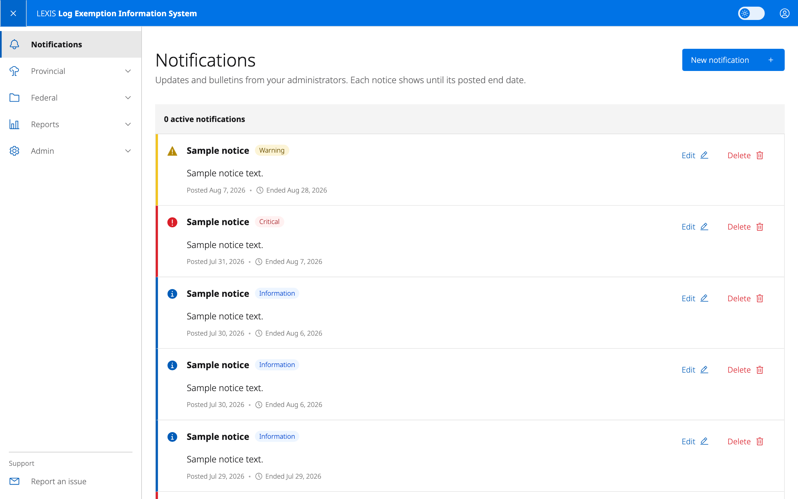
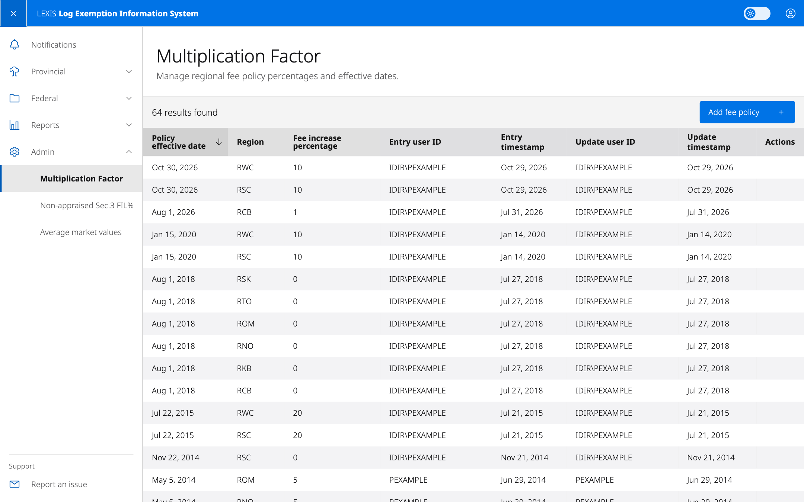
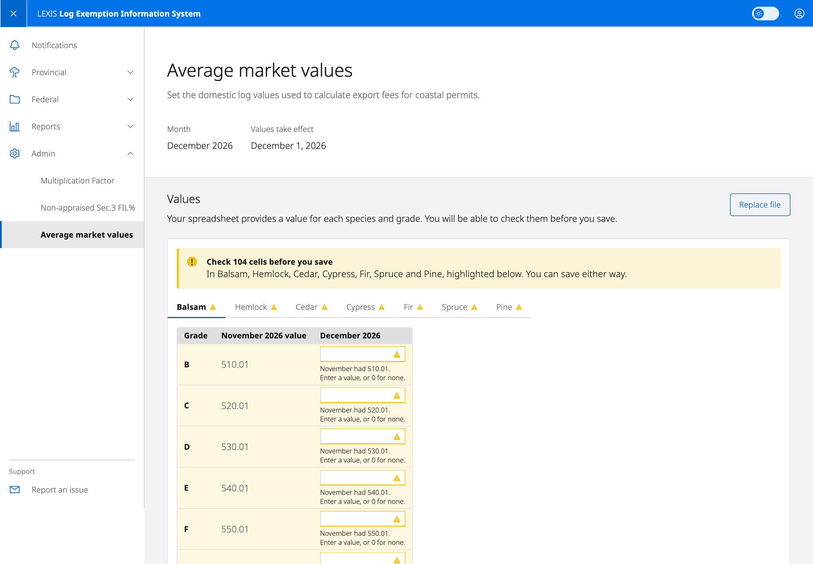

# 8. Administration <!-- roles: administrator -->

The **Admin** menu holds the values LEXIS uses to calculate the fee in lieu
of manufacture on permits.

## Who gets access is managed in FAM, not LEXIS

Roles, regions and forest clients are granted in **FAM (Forest Access
Management)**. LEXIS has no user administration screens. See [Who can do
what](09-who-can-do-what.md).

## Screens

| Menu item | Use it to |
|---|---|
| **Admin › Multiplication Factor** | Set the fee increase percentage for a region from an effective date. |
| **Admin › Non-appraised Sec.3 FIL%** | Set the fee in lieu percentage from an effective date. |
| **Admin › Average market values** | Load next month's domestic log values, used to calculate export fees for coastal permits. |
| **Notifications** | Publish notices to LEXIS users. Every role reads notices here; only Administrators publish them. |

## Common tasks

### Publish a notification

1. **Notifications**, then **New notification**.
2. Enter a **Title** (up to 80 characters) and the **Message**. The message
   can use bold, italic, lists and links.
3. Choose the **Type**: **Information**, **Warning** or **Critical**.
4. Leave **All roles** ticked, or clear it and tick the roles that should
   see the notice.
5. Set the **Start date** and **End date**. The notice shows between those
   dates and then hides by itself. Nobody has to dismiss it.
6. Select **Publish**.

As an Administrator you see every notice, including scheduled and past
ones, with **Edit** and **Delete**. The start date of a published notice
can't be changed. Deleting a notice removes it for everyone at once. No
email is sent for a notice, and Federal Read Only users don't see notices.

### Add a multiplication factor

1. **Admin › Multiplication Factor**. The table lists every fee policy,
   newest effective date first.
2. Select **Add fee policy**.
3. Enter the **Policy effective date** (tomorrow or later), the **Region**
   and the **Fee increase percentage** (a whole number from 0 to 100).
4. Select **Save fee policy**.

A region can have one policy for each effective date. A permit uses the
percentage in effect for its region on its application date.

### Change or delete a policy

**Edit** and **Delete** appear only on rows with a future effective date. A
policy that has taken effect can't be changed: add a new one with a later
date instead. Deleting asks you to confirm and can't be undone.

### Set the non-appraised fee in lieu percentage

**Admin › Non-appraised Sec.3 FIL%** works the same way. Select **Add fee in
lieu policy**, then enter the **Policy effective date** and the **Fee in lieu
percentage** (a whole number from 1 to 99). There is one percentage for the
whole province for each effective date.

### Load next month's average market values

The page always works on next month. The header shows the **Month** and the
date the **Values take effect**. Earlier months can't be changed.

1. **Admin › Average market values**.
2. Select **Download template** if you need the spreadsheet. It has one row
   for each grade and one column for each species: Balsam, Hemlock, Cedar,
   Cypress, Fir, Spruce and Pine.
3. Drop the completed file on **Upload spreadsheet**, or select the area to
   choose it. The file must be `.xlsx` and no larger than 20 MB.
4. LEXIS checks the file. If it can't be used, the problems are listed: fix
   the spreadsheet and upload it again.
5. Review the values. Each species has a tab, and each grade shows last
   month's value beside the new one. A warning icon marks a value to check,
   for example a grade that had a value last month and has none now. You can
   correct a value on screen (0 to 9999.99, two decimal places).
6. Select **Save values**.

All the values are saved together, or none are. They stay editable until the
month starts: change a value and select **Save values** again, or select
**Replace file** to load a new spreadsheet.

> **Fixed values:** grades Z, BLANK and 1 to 6 are always $1.00 per cubic
> metre. They are saved automatically and are not shown on this page. The
> Pine value applies to all three pine species.
